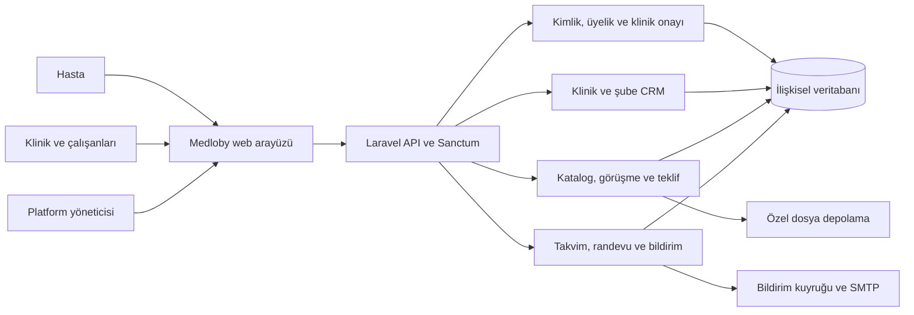

# Medloby mimarisi ve proje yol haritası

**İnceleme tarihi** 22 Kasım 2026 · **İncelenen sürüm** `main / 668980d`

**Güncel durum** Klinik ve personel hesapları, CRM takip hatırlatmaları ve sözleşme yönetim ekranı test ortamında tamamlandı. Canlı e-posta, üretim zamanlayıcısı ve yedeklemesi, işletmeci bilgileri ve KVKK onayları yayın öncesi kontrol listesinde takip ediliyor. [Yayın öncesi kontrol listesi](README.md#medloby-yayına-çıkmadan-önce)

## Kapsam ve doğrulama

GitHub'daki `main` ile geliştirme kopyasının aynı commit'te olduğu doğrulandı. Envanter, Git'in izlediği 375 dosyayı kapsadı. Uygulama, şema, ön yüz, testler, ayarlar, kilit dosyaları ve lisans bildirimleri incelendi. Yerel veri ve Git dışındaki dosyalar depo kapsamı dışında. Depoda 120 uygulama dosyası, 61 migration, 46 model, 11 servis ve 66 Feature test dosyası bulunuyor. Laravel rota listesindeki 164 API ve 2 web uç noktası esas alındı.

- PHP 8.4.28 ve Node 24.22.3 ile kilitli PHP ortam gereksinimleri, 291 PHP dosyasının sözdizimi, JavaScript sözdizimi ve Vite derlemesi geçti.
- Pest'te **781 test, 2.710 doğrulama** geçti. Bu sonuç testlerin SQLite kullandığı geliştirme ortamına ait.
- Mobil Chromium'da yapay verilerle başvuru, onaydan CRM’e geçiş, hasta adayı kaydı, sayfalama, filtreleme ve şube ayrımı doğrulandı.
- Tüm 61 migration yerel SQLite veritabanına uygulanmış. Klinik üyeliği için `0.2-draft` hazırlandı. Başvuru formu, geçerli ve yayımlanmış zorunlu sözleşme olduğunda açılır.
- Bu incelemedeki bağımlılık bulguları Aşama 1.3’te ele alındı. PHP kilit dosyası GitHub Advisory Database üzerinden tarandı.

## Mimari

Medloby tek Laravel uygulaması olarak çalışıyor. Laravel 13.40 ve Sanctum 4.3 kimlik doğrulama ve API erişimini, Eloquent ve migration dosyaları veriyi, Blade, Tailwind 4 ve Vite ise arayüzü yönetiyor. Web'de ana sayfa ve `/paket-teklifleri` var. Katalog, görüşmeler, yönetici diyalogları ve klinik CRM görünümü ikinci rota içinde yer alıyor. [Web rotaları](routes/web.php) · [Arayüz giriş noktası](resources/js/app.js) · [Bağımlılıklar](composer.json)

- İşletme ve şube ayrımı `Business`, `Branch`, `BusinessUser` ve şube üyeliği ilişkileri üzerinden kurulu. CRM istekleri doğrulanmış hesap, aktif ve onaylı işletme, aktif şube ve şube yetkisi kontrolünden geçer. Hasta kaydı ve klinik üyeliği aynı kullanıcı modeli üzerinden ayrı ilişkilerle yürür. [Kullanıcı modeli](app/Models/User.php) · [CRM erişim kontrolü](app/Http/Middleware/EnsureClinicCrmAccess.php)
- Klinik başvurusu e-posta, klinik adı, telefon ve sözleşme kabulüyle alınır. Yönetici onayıyla klinik sahibine kullanıcı kodu ve geçici şifre e-postayla gönderilir. Klinik sahibi ilk girişte şifresini değiştirip kendi CRM’ini açar. CRM’de klinik ve şube bilgilerini tamamlar ve personel için e-postasız hesap açar. [Başvuru](app/Http/Controllers/BusinessRegistrationController.php) · [Giriş](app/Http/Controllers/AuthController.php)
- Tedavi paketi seansları ve ek hizmetleri içerir. Hasta paket hakkında bir görüşme başlatabilir. Klinik özel teklif gönderir ve teklif anındaki paket içeriği saklanır. Hasta kabulden sonra şube, hekim ve uygun saat seçerek her tedavi seansı için ayrı randevu oluşturur. [Teklif](app/Http/Controllers/OfferController.php) · [Paket rezervasyonu](app/Services/AppointmentBookingService.php)
- Veritabanı geliştirmede SQLite, testlerde bellek içi SQLite kullanır. Görüşme ekleri özel dosya alanında saklanır ve indirme için erişim denetimi uygulanır. Bazı bildirimler kuyruk kullanır. Üretim veritabanı, depolama ve dağıtım yöntemi yayın hazırlığında doğrulanacaktır. [Veritabanı](config/database.php) · [Dosya ayarları](config/filesystems.php) · [Kuyruk](config/queue.php)

### Geliştirmede izlenecek yapı

- Yeni API işlemlerinde kimlik, rol ve işletme/şube kapsamı sunucuda doğrulanır. Denetleyiciler giriş doğrulamasını ve yanıtı yönetir. Teklif, randevu ve bildirim gibi iş kurallarında mevcut servis ve model ilişkileri kullanılır.
- Yeni ekranlar mevcut Blade düzeni ve özellik bazlı JavaScript dosyaları üzerinden ilerler. Klinik ve hasta akışları ortak oturum ve API istek mekanizmasını kullanır. API yanıtlarında ekranın ihtiyaç duyduğu alanlara öncelik verilir.
- Şema değişiklikleri migration ile işlenir. Mevcut veri ve çağıranlar için uyumluluk kontrol edilir. Koşullu erişim, durum geçişi ve şube ayrımı ilgili Feature testleriyle doğrulanır.

## Modüllerin güncel durumu

| Modül | Depoda çalışan bölüm | Tamamlanacak bölüm |
| --- | --- | --- |
| Hesaplar | Hasta kaydı, e-posta veya kullanıcı koduyla giriş, e-posta doğrulaması ve şifre sıfırlama. Klinik sahibinde ilk girişte şifre belirleme. Klinik tarafından açılan personel hesaplarında şifreyi klinik sahibi yönetir. | Yayın sırasında gerçek gelen kutusu ve hesap kurtarma testi |
| Klinik başvurusu | İletişim bilgileri ve sözleşme kabulüyle başvuru, yönetici inceleme/onay/ret, uygulama içi bildirim ve onay sonrasında giriş bilgilerini e-postaya gönderme | İşletmeci ve ruhsat doğrulama sürecini netleştirme, idari görevleri ve eksik yönetim ekranlarını bitirme |
| Sözleşmeler ve platform yönetimi | Sözleşme sürümleri, eşzamanlı taslak düzenleme denetimi, yürürlük ve bitiş tarihleri, yayımlama, yayından kaldırma ve sürüme göre kabul geçmişi. Klinik askıya alma ve üyelik yetki işlemleri için sunucu uç noktaları | Onaylanan sözleşmeyi canlı ortamda yayımlama, klinik durum geçmişi ve üyelik yönetimi ekranları |
| CRM hasta adayları | Şube seçimi ve özet, aday listeleme, durum filtresi, sayfalama, iletişim bilgilerini düzenleme ve personele atama. Takip aşaması ekleme, aşama geçmişi ve aday sonuçlandırma | Klinik takvimi ve operasyon ekranlarıyla birlikte doğrulama |
| CRM görevleri ve takip | Adaya bağlı görev, planlı takip, aktivite kayıtları, süreye ve atamaya göre takip hatırlatması. Görev ve takiplerin tamamlanması ve iptali. Yetkili şube görüşmesini ve hastayı adaya bağlama | Üretim zamanlayıcısıyla takip bildirimi provası |
| Klinik operasyonları | Klinik ve şube profili, e-postasız personel hesabı ve şube yetkisi, hekim kaydı, şube ve tedavi bağlantıları, çevrimiçi randevu ayarları. Randevu süresi, günlük şube takvimi, hekim çalışma saatleri ve izinleri, açık ve kapalı günler, saat engelleri | Yayın ortamında ilk klinik için uçtan uca prova |
| Katalog ve fiyat | Tedavi, kategori ve fiyat kayıtları. Klinik paketleri, seans ve ek hizmet yönetimi. Paket, klinik, tedavi ve il araması. Yetkili kliniğe açık fiyat kayıtları ve hastaya özel paket teklifi | Yayımlanacak katalog kayıtlarının içerik incelemesi |
| Görüşme ve teklif | Paketle görüşme başlatma, mesaj ve özel ek, teklif oluşturma, kabul/ret ve paket içeriği kaydı | Farklı şube ve rollerin görmesi gereken verileri tutarlı hale getirme, geçmiş kayıt ve dosya saklama kurallarını belirleme |
| Randevu | Uygun saat arama, tekil randevu ve kabul edilen paket seanslarının planlanması. Klinik takviminde onay, iptal, tarih değişikliği, tamamlanma ve hasta gelmedi işlemleri | Seçilecek üretim veritabanında eşzamanlı rezervasyon testi |
| Bildirim | Klinik başvurusu, görüşme, teklif, randevu ve CRM takip bildirimleri. Okunma durumu ve klinik tercihleri | Üretim zamanlayıcısı, kuyruk işçisi ve canlı e-posta teslimatı |
| Sağlık verisi ve bekleme listesi | Tıbbi kayıt, onam ve bekleme listesi için şema ve modeller | Kullanıcı akışları, erişim ve saklama kararları. Bu modüllerin kapsamı ürün kararıyla belirlenecek |
| Yayın ve operasyon | Yerel kurulum, kilit dosyaları, derleme ve test altyapısı, yerel font ve lisans bildirimleri | Medloby ana sayfası, otomatik test/derleme, üretim kurulumu, yedek ve geri yükleme, izleme ve yayın kontrol listesi |

Sunucu tarafında CRM, takvim, yönetim ve başvurunun temel kavramları mevcut. Adayı sonuçlandırma işlemi durum ve tarih güncelliyor. Klinik ekranına bu adım bağlanmadan önce gerçek hasta profiline bağlamanın hangi durumda yapılacağı ve raporların hangi durumları sayacağı netleşecek. Mevcut sunucu işlevi için [CRM aday işlemleri](app/Http/Controllers/CrmLeadController.php) ve [CRM raporu](app/Http/Controllers/CrmDashboardController.php) referans alınır.

## Geliştirme sırası

### 1. Erişim ve veri tutarlılığı

- [x] **1.1** Katalog yönetiminde 27 yazma rotasına doğrulanmış hesap ve ilgili rol/işletme/şube kontrolleri uygulandı. 157 ilgili test ve 787 testlik tam süit geçti. [Yetki değişiklikleri](https://github.com/medloby/medloby/commit/47195478eea381f9385883aa52ae405ee0f65d84)
- [x] **1.2** Katalog, CRM ve görüşme erişiminde işletme ve şube kapsamı uygulandı.
  - [x] Onaylı kliniklerin aktif paket ve hizmetleri kamuya açık katalogda yayımlanıyor. Tedavi fiyatları ve görüşmede teklif hazırlamak için kullanılan paket fiyatları doğrulanmış, yetkili klinik hesaplarına açık. 790 test geçti. Chromium’da katalogdan görüşme açma, özel teklif gönderme, hasta kabulü ve seans planlama ekranına geçiş doğrulandı. [Katalog değişiklikleri](https://github.com/medloby/medloby/commit/24b4e6552b52ed0b39e584dc81b725fbc6fca408)
  - [x] CRM adayı, aynı şubede görüşmesi veya doğrulanabilir randevusu olan hastaya ve yetkili personele bağlanabiliyor. Görüşmeler, mesajlar, teklifler ve ekler klinik ve şube yetkisine göre açılıyor. Şube seçilmeden açılan görüşmeler aktif klinik üyelerine açık. Klinik askıya alındığında hasta geçmişini görebiliyor ve yeni görüşme, mesaj, teklif yanıtı ve teklife bağlı randevu işlemleri duruyor. 795 test geçti. [CRM ve görüşme erişimi](https://github.com/medloby/medloby/commit/7ed1d7fcca430dfc8095e44ad8eb0e06145f3575)
- [x] **1.3** Güvenlik duyurularına göre iki PHP ve dört JavaScript paketinin kilitli sürümleri güncellendi. Güncel kilit dosyalarında `npm audit` ve GitHub Advisory Database taramaları eşleşen güvenlik bildirimi bulmadı. PHP ortam gereksinimleri, 795 test ve Vite derlemesi geçti. [Bağımlılık güncellemeleri](https://github.com/medloby/medloby/commit/214a18389834151e15f136f317b4a1e534e9af87)

Aşama, olumsuz yetki testleri ve kendi kliniğinde çalışan olumlu akışlarla tamamlanır. Bundan sonra CRM düzenleme ekranına geçilir.

### 2. Klinik CRM’i tamamla

1. **2.1 Tamamlandı.** Hasta adayının ayrıntısı açılıyor ve iletişim bilgileri düzenlenebiliyor. Sorumlu personel seçimi şubenin aktif ve yetkili üyeleriyle sınırlı. Atama değişikliği ve kaldırma, güncelleme sonrası sayfa ve filtreyi koruma ve şubeler arasında geçiş mobil Chromium’da doğrulandı. 796 test ve Vite derlemesi geçti. [CRM aday ekranı](https://github.com/medloby/medloby/commit/3eff17386f692ae46db3c7503627e055f7466cef)
2. **2.2 Tamamlandı.** Klinik takip aşaması ekleyebiliyor, adayı aktif bir aşamaya taşıyabiliyor ve tarih, personel ve notla birlikte aşama geçmişini görebiliyor. Başarılı ve sonuçsuz kapanışlar özet ve aday filtresinde aynı sonucu veriyor. Eski başarılı kayıtlar da bu sayımlara dahil. 798 test ve mobil Chromium akışı geçti. [Aday takibi ve sonuçlandırma](https://github.com/medloby/medloby/commit/f6385e8a429241413526fb526b21c3c93b27e170)
3. **2.3 Tamamlandı.** Aday ayrıntısında görev, planlı takip ve aktivite oluşturulabiliyor ve düzenlenebiliyor. Görev ve takip tamamlanabiliyor ya da iptal edilebiliyor. Aynı şubedeki uygun bir görüşme seçilerek adaya bağlanıyor. Hasta bağlantısı boşsa açık seçimle görüşmedeki hasta da adaya bağlanıyor. 799 test, Vite derlemesi ve mobil Chromium akışları geçti. [Aday görevleri ve görüşme bağlantısı](https://github.com/medloby/medloby/commit/42121c523a29c4d8bc75082fdead3e6eb6137893)
4. **2.4 CRM takip hatırlatmaları tamamlandı.** Saati gelen bekleyen takip, şubeye erişimi olan atanmış personele bildirilir. Atama yoksa veya sorumlunun şube yetkisi sona ermişse bildirim aktif klinik sahibine gider. Bildirim takibin planlanan saatini gösterir ve ilgili kaydı açar. Tarih veya sorumlu değişirse yeni plan için bildirim oluşturulur. Tamamlanmış ve iptal edilmiş takipler ile sonuçlanmış adaylar hatırlatma almaz. Masaüstü ve mobil Chromium’da planlama, bildirimden şubeye geçiş ve kaydı tamamlama doğrulandı. 827 test, 3.511 doğrulama ve Vite derlemesi geçti. [Takip hatırlatma testi](tests/Feature/CrmFollowUpReminderTest.php)

Kabul senaryosu e-posta doğrulama ve klinik onayıyla başlar. Klinik sahibi yalnızca yetkili olduğu şubede adayı oluşturur, izler ve sonuçlandırır. Chrome kontrolü sırasında şube değiştirme, onaydan önce erişim ve farklı klinik sınırı tekrar sınanır.

### 3. Klinik operasyonu ve randevu

1. **3.1 Tamamlandı.** Klinik sahibi doğrulanmış bir Medloby hesabına seçili şube için personel yetkisi verebiliyor ve bu yetkiyi kaldırabiliyor. Personel kendi yetkili şubelerinin CRM’ine girebiliyor. Klinik sahibi hekim oluşturabiliyor, hekimi şubeye ve aktif şube tedavilerine bağlayabiliyor, şube tedavisinin çevrimiçi randevu ayarını yönetebiliyor. Hekim–tedavi bağlantısı kliniğin o tedaviyi sunduğu bağlı şubelerde geçerli. 802 test, Vite derlemesi ve mobil Chromium akışları geçti. [Klinik operasyonları](https://github.com/medloby/medloby/commit/e8c3c284bf5ed34dc8c624000aefb7825f6d1122)
2. **3.2 Tamamlandı.** Klinik sahibi ve şubeye yetkili personel günlük randevuları ve saat engellerini görebiliyor. Klinik sahibi takvimden haftalık hekim çalışma saatlerini, izinleri, varsayılan gün kuralını, tarih istisnalarını ve şube ya da hekim saat engellerini yönetebiliyor. Kayıtlar yeni randevu uygunluğuna yansıyor. 804 test ve 3.060 doğrulama geçti. Vite derlemesi ve mobil Chromium’da klinik sahibi ile personel akışları doğrulandı. [Klinik takvimi](https://github.com/medloby/medloby/commit/5895582e3ea99df806934883324dc0a3c1c02d08)
3. **3.3 Tamamlandı.** Klinik takviminden tekil hasta randevusu ve hastanın kabul ettiği paket teklifindeki seanslar oluşturulabiliyor. Paketin seansları tek işlemde kaydediliyor ve bir seans uygunsuzsa kayıtlar geri alınıyor. Klinik sahibi ve yetki verilen personel kendi şubesindeki randevular için işlem yapabiliyor. Şube dışındaki hasta profiliyle ilişkilendirme ve aynı hekimin başka şubedeki saat çakışması engelleniyor. Şube tedavilerinde randevu süresi ayarlanabiliyor. SQLite üzerinde 807 test ve 3.131 doğrulama geçti. Vite derlemesi ve mobil Chromium’da randevu, paket ve personel akışları doğrulandı. [Takvimden randevu yönetimi](https://github.com/medloby/medloby/commit/5d2d304c6b538aea3a6136fe5ade90b67a354bd1)

Kabul senaryosu şubede hekim ve uygunluk hazırlığından başlayıp hastanın birkaç seansı seçmesi ve kliniğin randevuyu yönetmesiyle tamamlanır.

### 4. Kamuya açık site ve yayın içeriği

1. **4.1 Uygulama tamamlandı.** Medloby ana sayfasından tedavi paketi arama, hesap ve klinik başvurusu açılıyor. Katalog klinik, konum, tedavi seansları ve ek hizmetleri gösteriyor. Fiyat teklifleri ilgili hastanın hesabında görüntüleniyor. Hasta, katalogdan seçtiği paketin görüşmesini doğrulanmış hesabında başlatabiliyor. 808 test ve 3.155 doğrulama, Vite derlemesi ve masaüstü ile mobil Chromium kontrolleri geçti. [Ana sayfa ve katalog](https://github.com/medloby/medloby/commit/2c1a937c756527e89c862bfd30779e205602ca86)
2. **4.2 Taslaklar ve teknik hazırlık tamamlandı.** Hasta ve klinik için ayrı KVKK metinleri, kayıt formu bağlantıları, iletişim ayarları ve veri işleme ile saklama planı hazırlandı. Klinik üyelik sözleşmesi `0.2-draft` sürümüne taşındı. Randevu e-postaları kullanıcıyı hesabına yönlendiriyor, ayrıntılar yetkili hesap içinde gösteriliyor. 811 test, Vite derlemesi ve mobil Chromium kontrolleri geçti. İşletmeci ve iletişim bilgileri ile saklama ve işleme onayları yayın öncesi kontrol listesine alındı. Hizmet sağlayıcılar yayın öncesinde doğrulanacak. [KVKK hazırlığı](https://github.com/medloby/medloby/commit/a83b9ec2c6febea6ed1ab2ec83e4372254abe95f) · [Veri işleme ve saklama planı](resources/contracts/medloby-veri-isleme-ve-saklama-taslagi.md)
3. **4.3 Sözleşme yönetim ekranı tamamlandı.** Platform yöneticisi sürümün yürürlük ve bitiş tarihlerini ayarlayabilir, taslağı yayımlayabilir ve yayımlanmış sürümü yayından kaldırabilir. Başvuru formu yürürlükteki sözleşmeyi gösterir. Yönetici önceki sürümlerin metnini ve her sürümü kabul eden kliniklerin kayıtlarını açabilir. Yayımlama, mobil başvuruda sözleşmenin kabulü ve yayından kaldırma Chromium’da test verileriyle doğrulandı. 830 test, 3.550 doğrulama ve Vite derlemesi geçti. [Sözleşme yönetimi testleri](tests/Feature/AdminPlatformContractTest.php)
4. **4.4 Yayın öncesi onay.** Yayımlanacak sözleşme sürümünü ve yürürlük tarihini onayla. Yayımlanacak katalog kayıtlarını ve klinik bilgilerinin sunumunu sağlık tanıtımı kurallarına göre incele. [Klinik üyelik taslağı](resources/contracts/medloby-klinik-uyelik-taslak.txt) · [Sağlık Hizmetlerinde Tanıtım ve Bilgilendirme Faaliyetleri Hakkında Yönetmelik](https://www.resmigazete.gov.tr/eskiler/2025/11/12/20251112-2.htm)

Kamuya açılış için içeriğin uygunluğu, onaylı sözleşme ve kişisel veri süreçleri doğrulanır. Tıbbi kayıt, bekleme listesi, platform içi ödeme ve varsa uluslararası sağlık turizmi akışı için kapsam ayrıca kararlaştırılır.

### 5. Yayına hazırlık ve kontrollü açılış

1. **5.1 Otomatik derleme ve test iş akışı hazır.** GitHub Actions, `main` dalına gönderimlerde ve bu dalı hedefleyen pull request'lerde PHP 8.4 ve Node.js 24 ile kilitli bağımlılıkları kuruyor, Vite derlemesini ve Pest testlerini çalıştırıyor. Temiz çalışma kopyasında Vite derlemesi ve 811 test geçti. Üretim uygulamasının HTTPS, hata ayıklama, gizli ayarlar, depolama, veritabanı ve kuyruk ayarları yayın hazırlığında yapılacak. [İş akışı](.github/workflows/ci.yml)
2. **5.2 Yerel yedekleme ve geri yükleme provası tamamlandı.** SQLite veritabanı ve özel dosyalar birlikte yedekleniyor. Geri yükleme ayrı bir dizinde dosyaları ve veritabanını doğruluyor. Testte geri yüklenen kopyada son migration geri alınıp yeniden uygulandı ve görüşme eki yetkili hasta hesabından okundu. 814 test geçti. Üretim yedek takvimi, saklama süresi ve ilk yönetici kurulumu yayın hazırlığında ele alınacak. [Yerel SQLite provası](README.md#yerel-sqlite-yedekleme-ve-geri-yükleme)
3. İşletmeci ve iletişim bilgilerini doğrula, veri saklama sürelerini ve sağlık verilerinin işleme şartlarını onayla. [Yayın öncesi kontrol listesi](README.md#medloby-yayına-çıkmadan-önce)
4. Site tamamlandığında anlaşmaya göre canlı e-posta gönderimini bağla. Gönderen, destek adresi, SMTP, TLS ve gerçek gelen kutusu doğrulamasını tamamla. [Canlı e-posta maddesi](README.md#medloby-yayına-çıkmadan-önce)
5. **5.5 Test ortamında ilk klinik ve hasta provası tamamlandı.** Klinik, üyelik sözleşmesini kabul edip e-postasını doğruladı. Yönetici onayından sonra klinik sahibi CRM’e geçti, hekim ve çalışma saatlerini tanımladı, iki seanslık paket yayımladı. Hasta fiyat gösterilmeyen katalogdan görüşmeye geçti ve kendisine gönderilen özel teklifi kabul etti. Klinik sahibi hekimi çevrimiçi randevuya açınca hasta iki ayrı seans seçti. Klinik takviminde ilk randevu onaylandı ve hasta bildirimi hesabında gördü. Masaüstü ve mobil Chromium provasında e-posta bağlantıları yerel kayıttan açıldı ve teklif bildirimi veritabanı kuyruğundan işlendi. 815 test, 3.298 doğrulama ve Vite derlemesi geçti. Canlı ortamda son prova yayın öncesi kontrol listesinde. [Otomatik prova](tests/Feature/LaunchWorkflowTest.php)
6. **5.6 Hesap kurtarma tamamlandı.** Hasta ve klinik hesapları giriş ekranından şifre yenileme bağlantısı isteyebilir. Tek kullanımlık bağlantı 60 dakika geçerlidir ve şifre değişince mevcut erişim anahtarları iptal edilir. E-posta işi şifreli olarak mevcut kuyruğa eklenir. Giriş, hasta ve klinik kaydı, bağlantı isteme ve şifre yenileme denemelerinde istek sınırı uygulanır. Mobil Chromium’da yerel e-posta kuyruğundan alınan bağlantı ile şifre değiştirme ve yeniden giriş doğrulandı. 821 test, 3.384 doğrulama ve Vite derlemesi geçti. [Hesap kurtarma testleri](tests/Feature/AccountPasswordResetTest.php)
7. **5.7 Klinik başvuru bildirimleri tamamlandı.** Yeni başvurular doğrulanmış platform yöneticilerine, onay ve ret kararları aktif klinik sahiplerine uygulama içinden bildirilir. Yönetici bildirime tıklayarak ilgili incelemeyi açar. Klinik sahibi kendi başvuru sonucuna gider ve onaylanan başvurudan **CRM’e geç** düğmesiyle çalışma alanını açar. Ret açıklaması yetkili kişinin başvuru kartında görüntülenir. Masaüstü ve mobil Chromium’da iki karar yolu doğrulandı. 821 test, 3.408 doğrulama ve Vite derlemesi geçti. [Başvuru akışı testi](tests/Feature/LaunchWorkflowTest.php) · [Ret açıklaması ve yetki testi](tests/Feature/ClinicApplicationStatusTest.php)
8. **5.8 Klinik ve personel hesapları tamamlandı.** Kamuya açık form e-posta, klinik adı ve telefonla başvuru alır ve kabul edilen sözleşme sürümünü kaydeder. Onaydan sonra 48 saatlik geçici şifre ve kullanıcı kodu şifreli e-posta kuyruğuna eklenir. Klinik sahibi ilk girişte yeni şifresini belirler ve kendi CRM’inde klinik ile şube bilgilerini düzenler. Klinik sahibi personel hesabı için kullanıcı kodunu, şifreyi ve şube yetkisini belirler. Personel son şube yetkisini kaybettiğinde mevcut oturumu kapanır. Önceden açılmış hesaplar e-posta ile giriş yapabilir. Yönetici ekranı masaüstünde, klinik sahibi ve personel ekranları mobil Chromium’da doğrulandı. 824 test, 3.481 doğrulama ve Vite derlemesi geçti. [Klinik hesapları testi](tests/Feature/ClinicAccountOnboardingTest.php)

## Uygulama düzeni

Her turda sıradaki açık madde ele alınır. Yeni bir ihtiyaç gelirse önce bağlı olduğu aşama kaydedilir ve sıra bilinçli biçimde güncellenir. Bir madde tamamlandığında hangi akışın çalıştığı, hangi testlerin geçtiği ve GitHub commit’i işlenir. Doğrulanmış bir açık veya yayın engeli çıkarsa sırası ve gerekçesi dokümana yansıtılır.

Medloby’nin temel işlevleri kendi ortamında çalışabilmeli. Yeni bileşenlerde ücretsiz ticari kullanım, bağımlılık lisansları ve sağlayıcı değiştirilebilirliği korunur. [Proje kuralları](.ai/rules/general.md)
