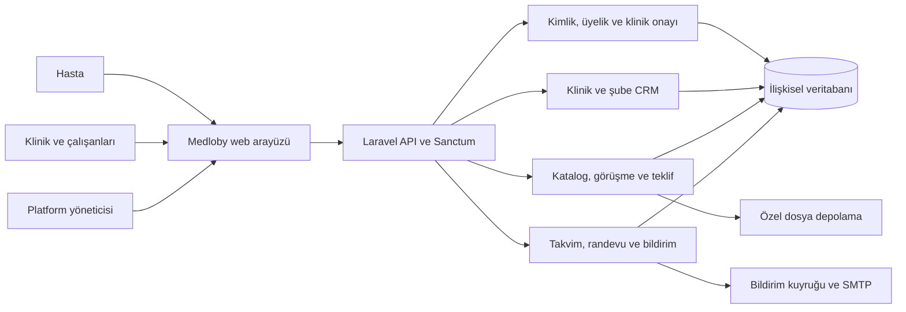

# Medloby mimarisi ve proje yol haritası

**İnceleme tarihi** 22 Kasım 2026 · **İncelenen sürüm** `main / 668980d`

**Sıradaki iş 2.2** Klinik CRM’de takip aşamasını değiştirmeyi, aşama geçmişini ve adayı sonuçlandırmayı ekrana bağlamak.

## Kapsam ve doğrulama

GitHub'daki `main` ile geliştirme kopyasının aynı commit'te olduğu doğrulandı. Envanter, Git'in izlediği 375 dosyayı kapsadı. Uygulama, şema, ön yüz, testler, ayarlar, kilit dosyaları ve lisans bildirimleri incelendi. Yerel veri ve Git dışındaki dosyalar depo kapsamı dışında. Depoda 120 uygulama dosyası, 61 migration, 46 model, 11 servis ve 66 Feature test dosyası bulunuyor. Laravel rota listesindeki 164 API ve 2 web uç noktası esas alındı.

- PHP 8.4.28 ve Node 24.22.3 ile kilitli PHP ortam gereksinimleri, 291 PHP dosyasının sözdizimi, JavaScript sözdizimi ve Vite derlemesi geçti.
- Pest'te **781 test, 2.710 doğrulama** geçti. Bu sonuç testlerin SQLite kullandığı geliştirme ortamına ait.
- Mobil Chromium'da yapay verilerle başvuru, onaydan CRM’e geçiş, hasta adayı kaydı, sayfalama, filtreleme ve şube ayrımı doğrulandı.
- Tüm 61 migration yerel SQLite veritabanına uygulanmış. Klinik üyeliği için `0.1-draft` mevcut. Başvuru formu, geçerli ve yayımlanmış zorunlu sözleşme olduğunda açılır.
- Bu incelemedeki bağımlılık bulguları Aşama 1.3’te ele alındı. PHP kilit dosyası GitHub Advisory Database üzerinden tarandı.

## Mimari

Medloby tek Laravel uygulaması olarak çalışıyor. Laravel 13.40 ve Sanctum 4.3 kimlik doğrulama ve API erişimini, Eloquent ve migration dosyaları veriyi, Blade, Tailwind 4 ve Vite ise arayüzü yönetiyor. Web'de ana sayfa ve `/paket-teklifleri` var. Katalog, görüşmeler, yönetici diyalogları ve klinik CRM görünümü ikinci rota içinde yer alıyor. [Web rotaları](routes/web.php) · [Arayüz giriş noktası](resources/js/app.js) · [Bağımlılıklar](composer.json)

- İşletme ve şube ayrımı `Business`, `Branch`, `BusinessUser` ve şube üyeliği ilişkileri üzerinden kurulu. CRM istekleri doğrulanmış hesap, aktif ve onaylı işletme, aktif şube ve şube yetkisi kontrolünden geçer. Hasta kaydı ve klinik üyeliği aynı kullanıcı modeli üzerinden ayrı ilişkilerle yürür. [Kullanıcı modeli](app/Models/User.php) · [CRM erişim kontrolü](app/Http/Middleware/EnsureClinicCrmAccess.php)
- Klinik başvurusu, işletme kaydıyla ilk şubeyi beklemede oluşturur ve kabul edilen sözleşme sürümünü kaydeder. E-posta doğrulaması ve yönetici onayı tamamlanınca klinik sahibi başvuru kartındaki **CRM’e geç** düğmesiyle kendi kliniğine geçer. Yeni başvuru kullanıcıyı CRM’e yönlendirmez. [Başvuru](app/Http/Controllers/BusinessRegistrationController.php) · [Başvuru durumu](app/Http/Controllers/ClinicApplicationStatusController.php)
- Tedavi paketi seansları ve ek hizmetleri içerir. Hasta paket hakkında bir görüşme başlatabilir. Klinik özel teklif gönderir ve teklif anındaki paket içeriği saklanır. Hasta kabulden sonra şube, hekim ve uygun saat seçerek her tedavi seansı için ayrı randevu oluşturur. [Teklif](app/Http/Controllers/OfferController.php) · [Paket rezervasyonu](app/Services/AppointmentBookingService.php)
- Veritabanı geliştirmede SQLite, testlerde bellek içi SQLite kullanır. Görüşme ekleri özel dosya alanında saklanır ve indirme için erişim denetimi uygulanır. Bazı bildirimler kuyruk kullanır. Üretim veritabanı, depolama ve dağıtım yöntemi yayın hazırlığında doğrulanacaktır. [Veritabanı](config/database.php) · [Dosya ayarları](config/filesystems.php) · [Kuyruk](config/queue.php)

### Geliştirmede izlenecek yapı

- Yeni API işlemlerinde kimlik, rol ve işletme/şube kapsamı sunucuda doğrulanır. Denetleyiciler giriş doğrulamasını ve yanıtı yönetir. Teklif, randevu ve bildirim gibi iş kurallarında mevcut servis ve model ilişkileri kullanılır.
- Yeni ekranlar mevcut Blade düzeni ve özellik bazlı JavaScript dosyaları üzerinden ilerler. Klinik ve hasta akışları ortak oturum ve API istek mekanizmasını kullanır. API yanıtlarında ekranın ihtiyaç duyduğu alanlara öncelik verilir.
- Şema değişiklikleri migration ile işlenir. Mevcut veri ve çağıranlar için uyumluluk kontrol edilir. Koşullu erişim, durum geçişi ve şube ayrımı ilgili Feature testleriyle doğrulanır.

## Modüllerin güncel durumu

| Modül | Depoda çalışan bölüm | Tamamlanacak bölüm |
| --- | --- | --- |
| Hesaplar | Hasta kaydı, giriş/çıkış, süreli imzalı e-posta doğrulaması ve yeniden gönderim | Şifre sıfırlama akışı, giriş ve kayıt istekleri için sınırlar, oturum davranışı ve yayın sırasında gerçek gelen kutusu testi |
| Klinik başvurusu | Geçerli sözleşme sürümüyle başvuru, yönetici inceleme/onay/ret, klinik sahibinin durum ve kendisine yazılan açıklamayı görmesi | İşletmeci ve ruhsat doğrulama sürecini netleştirme, idari görevleri ve eksik yönetim ekranlarını bitirme |
| Sözleşmeler ve platform yönetimi | Yönetici taslak listesi, düzenleme ve sürüm oluşturma, eşzamanlı değişiklik denetimi. Yayımlama, pasife alma, klinik askıya alma ve üyelik yetki işlemleri için sunucu uç noktaları | Yayımlama koşulları, geçmiş sözleşme ve kabul görünümü, klinik durum geçmişi ve üyelik yönetimi ekranları |
| CRM hasta adayları | Şube seçimi ve özet, takip aşaması sayıları, aday listeleme, durum filtresi, sayfalama, aday ekleme, ayrıntı ve iletişim bilgisi düzenleme, yetkili personele atama | Aşama değişikliği, aşama geçmişi ve sonuçlandırma |
| CRM görevleri ve takip | Görev, takip, aktivite ve görüşme ilişkilendirme uç noktaları. Takip aşaması yönetimi ve rapor verileri | Klinik ekranları, hasta ile ilişkilendirme akışı ve süresi gelen takiplerin nasıl işletileceği |
| Klinik operasyonları | Şube, şube tedavileri, hekim çalışma saatleri/izinleri, takvim kuralları, istisnalar ve bloklar için sunucu işlevleri | Operasyon ekranlarını mevcut uç noktalara bağlama, personel/şube yetkilerini ve hekim kurulum akışını doğrulama |
| Katalog ve fiyat | Tedavi, kategori ve fiyat kayıtları. Klinik paketleri, seans ve ek hizmet yönetimi. Fiyatsız kamu kataloğu, yetkili kliniğe açık fiyat kayıtları ve hastaya özel paket teklifi | Türkiye yayını için içerik incelemesi |
| Görüşme ve teklif | Paketle görüşme başlatma, mesaj ve özel ek, teklif oluşturma, kabul/ret ve paket içeriği kaydı | Farklı şube ve rollerin görmesi gereken verileri tutarlı hale getirme, geçmiş kayıt ve dosya saklama kurallarını belirleme |
| Randevu | Uygun saat arama, doktor ve şube kontrolleri, kabul edilen paketin seanslarını ayrı ayrı ayırma, durum ve geçmiş. Teklif ekranında hasta ve klinik için randevu özeti ve işlemleri | Klinik takvimini tek ekranda kullanılır hale getirme, seçilecek üretim veritabanında eşzamanlı rezervasyon testi |
| Bildirim | Görüşme, teklif ve randevu bildirimleri, okunma durumu ve klinik tercihleri | Klinik başvuru bildirimleri ve takip hatırlatmalarının kapsamı, kuyruk işçisi ve canlı e-posta teslimatı |
| Sağlık verisi ve bekleme listesi | Tıbbi kayıt, onam ve bekleme listesi için şema ve modeller | Kullanıcı akışları, erişim ve saklama kararları. Bu modüllerin kapsamı ürün kararıyla belirlenecek |
| Yayın ve operasyon | Yerel kurulum, kilit dosyaları, derleme ve test altyapısı, yerel font ve lisans bildirimleri | Medloby ana sayfası, otomatik test/derleme, üretim kurulumu, yedek ve geri yükleme, izleme ve yayın kontrol listesi |

Sunucu tarafında CRM, takvim, yönetim ve başvurunun temel kavramları mevcut. Adayı sonuçlandırma işlemi durum ve tarih güncelliyor. Klinik ekranına bu adım bağlanmadan önce gerçek hasta profiline bağlamanın hangi durumda yapılacağı ve raporların hangi durumları sayacağı netleşecek. Mevcut sunucu işlevi için [CRM aday işlemleri](app/Http/Controllers/CrmLeadController.php) ve [CRM raporu](app/Http/Controllers/CrmDashboardController.php) referans alınır.

## Geliştirme sırası

### 1. Erişim ve veri tutarlılığı

- [x] **1.1** Katalog yönetiminde 27 yazma rotasına doğrulanmış hesap ve ilgili rol/işletme/şube kontrolleri uygulandı. 157 ilgili test ve 787 testlik tam süit geçti. [Yetki değişiklikleri](https://github.com/medloby/medloby/commit/47195478eea381f9385883aa52ae405ee0f65d84)
- [x] **1.2** Katalog, CRM ve görüşme erişiminde işletme ve şube kapsamı uygulandı.
  - [x] Onaylı kliniklerin aktif paket ve hizmetleri kamuya açık katalogda yayımlanıyor. Tedavi fiyatları ve görüşmede teklif hazırlamak için kullanılan paket fiyatları doğrulanmış, yetkili klinik hesaplarına açık. 790 test geçti. Chromium’da katalogdan görüşme açma, özel teklif gönderme, hasta kabulü ve seans planlama ekranına geçiş doğrulandı. [Katalog değişiklikleri](https://github.com/medloby/medloby/commit/24b4e6552b52ed0b39e584dc81b725fbc6fca408)
  - [x] CRM adayı, aynı şubede görüşmesi veya doğrulanabilir randevusu olan hastaya ve yetkili personele bağlanabiliyor. Görüşmeler, mesajlar, teklifler ve ekler klinik ve şube yetkisine göre açılıyor. Şube seçilmeden açılan görüşmeler aktif klinik üyelerine açık. Klinik askıya alındığında hasta geçmişini görebiliyor ve yeni görüşme, mesaj, teklif yanıtı ve teklife bağlı randevu işlemleri duruyor. 795 test geçti. [CRM ve görüşme erişimi](https://github.com/medloby/medloby/commit/7ed1d7fcca430dfc8095e44ad8eb0e06145f3575)
- [x] **1.3** Güvenlik duyurularına göre iki PHP ve dört JavaScript paketinin kilitli sürümleri güncellendi. Güncel kilit dosyalarında `npm audit` ve GitHub Advisory Database taramaları eşleşen güvenlik bildirimi bulmadı. PHP ortam gereksinimleri, 795 test ve Vite derlemesi geçti. [Bağımlılık güncellemeleri](https://github.com/medloby/medloby/commit/214a18389834151e15f136f317b4a1e534e9af87)

Aşama, olumsuz yetki testleri ve kendi kliniğinde çalışan olumlu akışlarla tamamlanır. Bundan sonra CRM düzenleme ekranına geçilir.

### 2. Klinik CRM’i tamamla

1. **2.1 Tamamlandı.** Hasta adayının ayrıntısı açılıyor ve iletişim bilgileri düzenlenebiliyor. Sorumlu personel seçimi şubenin aktif ve yetkili üyeleriyle sınırlı. Atama değişikliği ve kaldırma, güncelleme sonrası sayfa ve filtreyi koruma ve şubeler arasında geçiş mobil Chromium’da doğrulandı. 796 test ve Vite derlemesi geçti. [CRM aday ekranı](https://github.com/medloby/medloby/commit/3eff17386f692ae46db3c7503627e055f7466cef)
2. Takip aşaması ve aşama geçmişi. Adayın sonuçlandırılması, eski kayıtların uyumu ve rapor/filtreden aynı sonucun görülmesi.
3. Görevler, takipler ve aktiviteler. Mevcut görüşmeyi izinli şekilde adaya bağlama.

Kabul senaryosu e-posta doğrulama ve klinik onayıyla başlar. Klinik sahibi yalnızca yetkili olduğu şubede adayı oluşturur, izler ve sonuçlandırır. Chrome kontrolü sırasında şube değiştirme, onaydan önce erişim ve farklı klinik sınırı tekrar sınanır.

### 3. Klinik operasyonu ve randevu

1. Klinik personeli ve şubeye yetki verme akışı, hekim ve tedavi ilişkilendirmesi.
2. Takvim, çalışma saatleri, izin ve kapalı gün ekranları.
3. Paket ve kişi bazlı randevu akışlarını klinik takvimiyle birleştir. Teklif dışındaki randevu işlemlerinde klinik durumunu ve hasta bağlantısını doğrula. Seansların tamamını kaydetme, çakışma, iptal ve yeniden planlamayı doğrula.

Kabul senaryosu şubede hekim ve uygunluk hazırlığından başlayıp hastanın birkaç seansı seçmesi ve kliniğin randevuyu yönetmesiyle tamamlanır.

### 4. Kamuya açık site ve yayın içeriği

1. Ana sayfa ve katalog içeriğini bitir. Türkiye için sağlık tanıtımı ve bilgilendirme kurallarına göre kamuya açık içerik ve özel teklif görünümünü incele.
2. Klinik üyelik sözleşmesinin işletmeci, destek ve tebligat bilgilerini doldur. Hasta ve klinik için gerekli KVKK aydınlatması, başvuru kanalı, saklama ve erişim kurallarını tamamla.
3. Yayımlanacak sürümü ve yürürlük tarihini onayla. Sözleşme ve katalog incelemesinde bu kaynaklar kullanılır. [Klinik üyelik taslağı](resources/contracts/medloby-klinik-uyelik-taslak.txt) · [Sağlık Hizmetlerinde Tanıtım ve Bilgilendirme Faaliyetleri Hakkında Yönetmelik](https://www.resmigazete.gov.tr/eskiler/2025/11/12/20251112-2.htm)

Kamuya açılış için içeriğin uygunluğu, onaylı sözleşme ve kişisel veri süreçleri doğrulanır. Tıbbi kayıt, bekleme listesi, platform içi ödeme ve varsa uluslararası sağlık turizmi akışı için kapsam ayrıca kararlaştırılır.

### 5. Yayına hazırlık ve kontrollü açılış

1. Otomatik derleme ve test çalıştırmasını ekle. Üretim uygulaması için HTTPS, kapalı hata ayıklama, gizli ayarlar, depolama, veritabanı ve kuyruk işçisini hazırla.
2. Veritabanı ve özel dosyaların yedeklenmesini kur. Geri yükleme, migration ve geri dönüş provasını test ortamında yap. İlk yönetici ve üretim verisi kurulumunu kontrollü hale getir.
3. Site tamamlandığında anlaşmaya göre canlı e-posta gönderimini bağla. Gönderen, destek adresi, SMTP, TLS ve gerçek gelen kutusu doğrulamasını tamamla. [Canlı e-posta maddesi](README.md#medloby-yayına-çıkmadan-önce)
4. İlk klinik ve hasta için başvuru, kabul, CRM, özel teklif, seans randevusu ve bildirim akışını yayın koşullarında doğrula.

## Uygulama düzeni

Her turda sıradaki açık madde ele alınır. Yeni bir ihtiyaç gelirse önce bağlı olduğu aşama kaydedilir ve sıra bilinçli biçimde güncellenir. Bir madde tamamlandığında hangi akışın çalıştığı, hangi testlerin geçtiği ve GitHub commit’i işlenir. Doğrulanmış bir açık veya yayın engeli çıkarsa sırası ve gerekçesi dokümana yansıtılır.

Medloby’nin temel işlevleri kendi ortamında çalışabilmeli. Yeni bileşenlerde ücretsiz ticari kullanım, bağımlılık lisansları ve sağlayıcı değiştirilebilirliği korunur. [Proje kuralları](.ai/rules/general.md)
