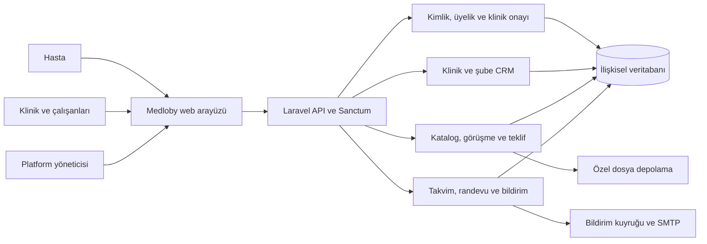

# Medloby mimarisi ve proje yol haritası

**İnceleme tarihi** 23 Kasım 2026 · **Envanterin dayandığı sürüm** `main / 55f1bd2`

**Güncel durum** İlk sürümün klinik başvurusu ve onayı, şube yetkili CRM, hasta görüşmesi, özel teklif ve seans randevusu akışları test ortamında doğrulandı. Ücretsiz klinik planı seçimi, bekleme bildirimi, destek talepleri, hasta süreci, seyahat planı ve şube gelir-gider takibi de çalışıyor. Canlı kurulum ve ilk klinikle yapılacak yayın provası için aşağıdaki sıra izlenir. [Yayın öncesi kontrol listesi](README.md#medloby-yayına-çıkmadan-önce)

## Kapsam ve doğrulama

Envanter, Git'in izlediği 539 dosyayı kapsadı. Depoda 179 uygulama dosyası, 75 migration, 53 model, 18 servis ve 92 Feature test dosyası bulunuyor. Uygulamanın rota listesinde 261 API ucu ve 8 web veya sistem rotası var. [API rotaları](routes/api.php)

- 428 PHP dosyasının sözdizimi, PHP paket gereksinimleri, Blade önbelleği ve Vite derlemesi doğrulandı.
- SQLite üzerinde **1.060 test**, PostgreSQL 17 üzerinde **1.063 test** geçti. PostgreSQL’e özel üç yedekleme senaryosu PostgreSQL aşamasında çalıştı.
- Chromium’da masaüstü klinik sahibi, mobil şube personeli ve mobil hasta girişleri ile ilgili çalışma alanları doğrulandı.
- Yerel kopyada bekleyen 14 şema güncellemesi ayrı bir deneme veritabanında uygulandı. 75 migration tamamlandı, ikinci çalıştırmada bekleyen kayıt kalmadı ve teknik kontrol şemayı hazır gösterdi.
- Klinik üyeliği için `0.2-draft` hazırlandı. Başvuru formu, geçerli ve yayımlanmış zorunlu sözleşme olduğunda açılır.
- `npm audit` taramasında ve kilitli 133 PHP paket sürümü için GitHub Advisory Database taramasında eşleşen bildirim bulunmadı.

## İlk sürüm için kalan sıra

1. **Canlı ortamı belirle.** Alan adı, HTTPS, sunucu ve veritabanı seçiminin ardından yayın ayarları, özel dosya alanı ve veritabanı şeması deneme ortamında doğrulanır. [Yayın ortamı kontrolü](README.md#medloby-yayına-çıkmadan-önce)
2. **İşletmeci ve yayın içeriğini onayla.** Resmî unvan, tebligat adresi, destek ve KVKK iletişim kanalları, veri işleme ve saklama süreleri ile sözleşmenin sürümü ve yürürlük tarihi kesinleşir. İlk kliniklerin bilgileri ve kamuya açılacak katalog içerikleri gözden geçirilir. [İçerik ve yayın onayı](#4-kamuya-açık-site-ve-yayın-içeriği)
3. **Canlı servisleri dene.** İlk platform yöneticisi kurulumu, SMTP teslimatı, arka plan kuyruğu, zamanlayıcı, erişim izlemesi ve şifreli yedeğin ayrı veritabanına dönüşü doğrulanır. [Operasyon kontrol listesi](README.md#medloby-yayına-çıkmadan-önce)
4. **İlk klinik ve hasta provasını tamamla.** Yayın koşullarında klinik onayı, personel yetkisi, görüşme eki, özel teklif, paket seansları ve eşzamanlı randevu seçimi deneme hesaplarıyla baştan sona çalıştırılır. [İlk klinik ve hasta provası](tests/Feature/LaunchWorkflowTest.php)

## Mimari

Medloby tek Laravel uygulaması olarak çalışıyor. Laravel 13.40 ve Sanctum 4.3 kimlik doğrulama ve API erişimini, Eloquent ve migration dosyaları veriyi, Blade, Tailwind 4 ve Vite ise arayüzü yönetiyor. Web'de ana sayfa ve `/paket-teklifleri` var. Katalog, görüşmeler, yönetici diyalogları ve klinik CRM görünümü ikinci rota içinde yer alıyor. [Web rotaları](routes/web.php) · [Arayüz giriş noktası](resources/js/app.js) · [Bağımlılıklar](composer.json)

- İşletme ve şube ayrımı `Business`, `Branch`, `BusinessUser` ve şube üyeliği ilişkileri üzerinden kurulu. CRM istekleri doğrulanmış hesap, aktif ve onaylı işletme, aktif şube ve şube yetkisi kontrolünden geçer. Hasta kaydı ve klinik üyeliği aynı kullanıcı modeli üzerinden ayrı ilişkilerle yürür. [Kullanıcı modeli](app/Models/User.php) · [CRM erişim kontrolü](app/Http/Middleware/EnsureClinicCrmAccess.php)
- Klinik başvurusu e-posta, klinik adı, telefon ve sözleşme kabulüyle alınır. Yönetici onayıyla klinik sahibine kullanıcı kodu ve geçici şifre e-postayla gönderilir. Klinik sahibi ilk girişte şifresini değiştirip kendi CRM’ini açar. CRM’de klinik ve şube bilgilerini tamamlar ve personel için e-postasız hesap açar. [Başvuru](app/Http/Controllers/BusinessRegistrationController.php) · [Giriş](app/Http/Controllers/AuthController.php)
- Tedavi paketi seansları ve ek hizmetleri içerir. Hasta paket hakkında bir görüşme başlatabilir. Klinik özel teklif gönderir ve teklif anındaki paket içeriği saklanır. Hasta kabulden sonra şube, hekim ve uygun saat seçerek her tedavi seansı için ayrı randevu oluşturur. [Teklif](app/Http/Controllers/OfferController.php) · [Paket rezervasyonu](app/Services/AppointmentBookingService.php)
- Varsayılan geliştirme veritabanı SQLite’tır. Eşzamanlı randevu testi, ayrı bir SQLite dosyasında veya PostgreSQL şemasında çalışır. Görüşme ekleri özel dosya alanında saklanır ve indirme için erişim denetimi uygulanır. Bazı bildirimler kuyruk kullanır. Üretim veritabanı, depolama ve dağıtım yöntemi yayın hazırlığında doğrulanacaktır. [Veritabanı](config/database.php) · [Dosya ayarları](config/filesystems.php) · [Kuyruk](config/queue.php)

### Geliştirmede izlenecek yapı

- Yeni API işlemlerinde kimlik, rol ve işletme/şube kapsamı sunucuda doğrulanır. Denetleyiciler giriş doğrulamasını ve yanıtı yönetir. Teklif, randevu ve bildirim gibi iş kurallarında mevcut servis ve model ilişkileri kullanılır.
- Yeni ekranlar mevcut Blade düzeni ve özellik bazlı JavaScript dosyaları üzerinden ilerler. Klinik ve hasta akışları ortak oturum ve API istek mekanizmasını kullanır. API yanıtlarında ekranın ihtiyaç duyduğu alanlara öncelik verilir.
- Şema değişiklikleri migration ile işlenir. Mevcut veri ve çağıranlar için uyumluluk kontrol edilir. Koşullu erişim, durum geçişi ve şube ayrımı ilgili Feature testleriyle doğrulanır.

## Modüllerin güncel durumu

| Modül | Depoda çalışan bölüm | Tamamlanacak bölüm |
| --- | --- | --- |
| Hesaplar | Hasta kaydı, e-posta veya kullanıcı koduyla giriş, e-posta doğrulaması ve şifre sıfırlama. Klinik sahibinde ilk girişte şifre belirleme. Klinik tarafından açılan personel hesaplarında şifreyi klinik sahibi yönetir. | Yayın sırasında gerçek gelen kutusu ve hesap kurtarma testi |
| Klinik başvurusu | İletişim bilgileri ve sözleşme kabulüyle başvuru, yönetici incelemesi ve karar bildirimi. Onayda giriş bilgileri, rette karar ve varsa başvuru sahibine özel açıklama e-postayla gönderilir. | İşletmeci ve ruhsat doğrulama sürecini netleştirme |
| Sözleşmeler ve platform yönetimi | Sözleşme sürümleri, taslak düzenleme denetimi, yürürlük ve bitiş tarihleri, yayımlama, yayından kaldırma ve kabul geçmişi. Klinik arama, askıya alma ve açma geçmişi, üye rolleri, üyelik durumu ve izinler | Onaylanan sözleşmeyi canlı ortamda yayımlama |
| CRM hasta adayları | Şube seçimi ve özet, aday listeleme, durum filtresi, sayfalama, iletişim bilgilerini düzenleme ve personele atama. Takip aşaması ekleme, aşama geçmişi ve aday sonuçlandırma. Bağlı hastanın şubedeki randevularını görme ve yetkiyle yeni randevu planlama | Yayın ortamında ilk klinik için uçtan uca prova |
| CRM görevleri ve takip | Adaya bağlı görev, planlı takip, aktivite kayıtları, süreye ve atamaya göre takip hatırlatması. Görev ve takiplerin tamamlanması ve iptali. Yetkili şube görüşmesini ve hastayı adaya bağlama | Üretim zamanlayıcısıyla takip bildirimi provası |
| Klinik operasyonları | Klinik ve şube profili, iletişim bilgilerinin yayın seçimi, yeni şube açma ve şube durumunu yönetme, şube sosyal medya bağlantıları, e-postasız personel hesabı, şubeye özel personel işlem izinleri, hekim kaydı, şube ve tedavi bağlantıları, çevrimiçi randevu ayarları. Randevu süresi, günlük şube takvimi, hekim çalışma saatleri ve izinleri, açık ve kapalı günler, saat engelleri | Yayın ortamında ilk klinik için uçtan uca prova |
| Katalog ve fiyat | Platform yöneticisinin ortak tedavi, kategori ve ek hizmet ekranları. Klinik sahibinin paket, seans ve kendi ek hizmetlerini yönetmesi. Paket, klinik, tedavi ve il araması. Klinik genelinde ve şubede yetkiye bağlı fiyat yönetimi. Hastaya özel paket teklifi | Yayımlanacak katalog kayıtlarının içerik incelemesi |
| Görüşme ve teklif | Paketle görüşme başlatma, mesaj ve yetkili dosya açma, teklif oluşturma, kabul/ret ve paket içeriği kaydı. Görüşme, teklif ve tekliften randevu yanıtlarında sınırlı profil ve dosya bilgileri | Geçmiş kayıt ve dosya saklama kurallarını belirleme |
| Randevu | Ana sayfadaki klinik aramasından tekil randevu alma ve kabul edilen paket seanslarını planlama. **Randevularım** ekranında hasta hesabına bağlı randevuların görüntülenmesi. Teklife bağlı randevularda şube kurallarına göre iptal ve tarih değişikliği. Klinik takviminde onay, iptal, tarih değişikliği, tamamlanma ve hasta gelmedi işlemleri. Yetkili şubede randevu kartını açma ve PDF indirme. SQLite ve PostgreSQL 17 üzerinde aynı hekimin saatine gelen eşzamanlı rezervasyon testi | Seçilecek üretim ortamında eşzamanlı rezervasyon provası |
| Bildirim | Klinik başvurusu, görüşme, teklif, randevu ve destek bildirimleri. CRM takip ve hasta randevu hatırlatmaları. Okunma durumu ve klinik tercihleri | Üretim zamanlayıcısı, kuyruk işçisi ve canlı e-posta teslimatı |
| Randevu bekleme listesi | Doğrulanmış hasta dolu bir gün için aynı şube, hekim ve tedavide bildirim isteyebilir ve isteğini kaldırabilir. Uygunluk bildirimi randevu ekranındaki seçimi açar. | Yayın ortamında zamanlayıcı ve bildirim provası |
| Hasta yolculuğu | Doğrulanmış hasta, görüşme başlangıcını, gelen teklif ve kararları, randevu kayıtları ve durum değişikliklerini **Tedavi sürecim** ekranında tarih sırasıyla görebilir. Her kayıt ilgili görüşme, teklif veya randevu ayrıntısını açar. | Yayın ortamında ilk hasta akışıyla birlikte prova |
| Seyahat planı | Klinik, konaklama veya transfer içeren kabul edilmiş teklifin seyahat ayrıntılarını düzenler. Hasta güncel planı kendi teklifinden görür. | Yayın ortamında klinikle konaklama ve transfer akışını prova etme |
| Finans | Şube bazında gelir ve gider kaydı, randevu veya paket tahsilatı bağlantısı, aylık ve yıllık raporlar, tüm dönemler ve yetkili şubeler özeti, hekim bazında randevu ve bağlı tahsilat raporu | Kayıt saklama ve resmî faturalama kapsamı |
| Destek | Hasta ve klinik hesapları destek talebi açabilir ve kendi taleplerini takip edebilir. Platform yöneticisi yanıtlayabilir, talebi kapatabilir veya yeniden açabilir. | Yayın öncesinde destek kayıtlarının saklama süresini belirleme |
| Tıbbi kayıt | Tıbbi kayıt için şema ve model | Sonraki aşamada kullanım kapsamı, yetkiler ve saklama kararları |
| Yayın ve operasyon | Yerel kurulum, otomatik derleme ve test, yerel font ve lisans bildirimleri, SQLite ve PostgreSQL 17 yedekleme ve geri yükleme provaları, `/up` adresinden uygulama ve veritabanı erişim kontrolü | Üretim kurulumu ve yedekleme, canlı izleme ve yayın öncesi kontroller |

İlk sürümde klinik başvurusunda **Başlangıç**, **Standart** ve **Profesyonel** üyelik planları ücretsiz ve isteğe bağlıdır. Seçim klinik sahibinin CRM’inde ve platform yönetim ekranlarında görünür. Resmî faturalama akışı ayrıca tanımlanacak. [Klinik başvuru akışı](app/Http/Controllers/BusinessRegistrationController.php)

Adayı sonuçlandırma işlemi durum ve tarih kaydeder. Adayın profil bağlantısı şubeyle ilişkisi doğrulanabilen hastalar için kurulur. Aday ayrıntısındaki randevu listesi bu profilin adayın şubesindeki kayıtlarıyla sınırlıdır. CRM özeti başarılı ve sonuçsuz adayları kayıtlı sonuca göre sayar. [CRM aday işlemleri](app/Http/Controllers/CrmLeadController.php) · [Aday randevuları](app/Http/Controllers/CrmLeadAppointmentController.php) · [CRM raporu](app/Http/Controllers/CrmDashboardController.php)

## Geliştirme sırası

### 1. Erişim ve veri tutarlılığı

- [x] **1.1** Katalog yönetiminde 27 yazma rotasına doğrulanmış hesap ve ilgili rol/işletme/şube kontrolleri uygulandı. 157 ilgili test ve 787 testlik tam süit geçti. [Yetki değişiklikleri](https://github.com/medloby/medloby/commit/47195478eea381f9385883aa52ae405ee0f65d84)
- [x] **1.2** Katalog, CRM ve görüşme erişiminde işletme ve şube kapsamı uygulandı.
  - [x] Onaylı kliniklerin aktif paket ve hizmetleri kamuya açık katalogda yayımlanıyor. Tedavi fiyatları ve görüşmede teklif hazırlamak için kullanılan paket fiyatları doğrulanmış, yetkili klinik hesaplarına açık. 790 test geçti. Chromium’da katalogdan görüşme açma, özel teklif gönderme, hasta kabulü ve seans planlama ekranına geçiş doğrulandı. [Katalog değişiklikleri](https://github.com/medloby/medloby/commit/24b4e6552b52ed0b39e584dc81b725fbc6fca408)
  - [x] CRM adayı, aynı şubede görüşmesi veya doğrulanabilir randevusu olan hastaya ve yetkili personele bağlanabiliyor. Görüşmeler, mesajlar, teklifler ve ekler klinik ve şube yetkisine göre açılıyor. Şube seçilmeden açılan görüşmeler aktif klinik üyelerine açık. Klinik askıya alındığında hasta geçmişini görebiliyor ve yeni görüşme, mesaj, teklif yanıtı ve teklife bağlı randevu işlemleri duruyor. 795 test geçti. [CRM ve görüşme erişimi](https://github.com/medloby/medloby/commit/7ed1d7fcca430dfc8095e44ad8eb0e06145f3575)
  - [x] Görüşme ve teklif yanıtlarında kişi, klinik ve ek dosya bilgileri sınırlandı. Hastanın telefonu ve doğum tarihi, personelin hesap e-postası ve dosyanın depolama bilgileri bu yanıtlardan çıkarıldı. CRM aday bağlantısı şube yetkisiyle açılan CRM işleminde görülür. Hasta ve klinik yetkileri, dosya açma, teklif yanıtı ve paket seanslarının kaydı test edildi. 836 test, 3.679 doğrulama ve Vite derlemesi geçti. [Görüşme testi](tests/Feature/ConversationTest.php) · [Teklif testi](tests/Feature/OfferTest.php)
- [x] **1.3** Güvenlik duyurularına göre iki PHP ve dört JavaScript paketinin kilitli sürümleri güncellendi. Güncel kilit dosyalarında `npm audit` ve GitHub Advisory Database taramaları eşleşen güvenlik bildirimi bulmadı. PHP ortam gereksinimleri, 795 test ve Vite derlemesi geçti. [Bağımlılık güncellemeleri](https://github.com/medloby/medloby/commit/214a18389834151e15f136f317b4a1e534e9af87)
- [x] **1.4** Eski ve güncel takvim uçları aynı klinik ve şube erişim kontrolünü kullanır. Takvim kuralı, tarih istisnası, saat engeli, hekim çalışma saati ve izin değişiklikleri aktif klinik sahibine açıktır. Şubeye atanmış personel mevcut görüntüleme, randevu ayarı ve kendisine verilen işlem yetkilerini kullanmaya devam eder. Takvim engeli gerekçesini klinik sahibi görür. 245 mevcut rota korunmuştur. SQLite ve PostgreSQL yapılandırmalarıyla 887’şer test geçti. Yerel SQLite üyelik tablosu boştu. Eski `owner` kayıtlarının üretim verisi varsa rol eşlemesi o veri üzerinden doğrulanacak. [Takvim yetki testleri](tests/Feature/ClinicCalendarTest.php)
- [x] **1.5** Tedavi fiyatı CRM’de klinik veya şube için alt ve üst tutar olarak kaydedilir. Hekime özel fiyatlar ekran ve API işlemlerinden kaldırıldı. Önceki hekim kayıtları veritabanında korunur. Eski sabit klinik ve şube fiyatları okunabilir, CRM’de düzenlenirse aralık olarak kaydedilir. [Fiyat testi](tests/Feature/TreatmentPriceControllerTest.php)
- [x] **1.6** Şube açma, pasife alma ve yeniden açma CRM ve eski API’de klinik sahibine aittir. Personel, kendisine atanmış aktif şubede verilmiş işlem izinlerini kullanır. [Şube işlemleri](app/Http/Controllers/BranchController.php) · [CRM şube yönetimi](app/Http/Controllers/ClinicProfileController.php)
  - [x] Eski şube API’sinde şube açma, düzenleme ve pasife alma için CRM’deki aktif ve onaylı klinik koşulu uygulanır. Onayı bekleyen, onaysız ve askıdaki kliniklerde bu işlemlerin reddedildiği test edildi. [Şube API testleri](tests/Feature/BranchControllerTest.php)
  - Yerel SQLite veritabanında işletme geneli `branches.manage` izni verilmiş hesap veya eski `owner` rolünde üyelik bulunmadı. Gerçek hesap ve istemci kullanımı yayın ortamı seçildiğinde doğrulanacak.
- [x] **1.7** Herkese açık şube tedavi listesi onaylı kliniklerin aktif şubelerini açar. Tedavinin katalogda ve ilgili şubede aktif olması gerekir. Klinik CRM’i pasif şube tedavilerini yetkiyle yönetebilir. [Şube tedavi testleri](tests/Feature/BranchTreatmentControllerTest.php)
- [x] **1.8** Görüşme eki yüklenirken mesaj işlemi geri alınırsa yazılan dosya özel depodan temizlenir. Kayıt hatası simüle edilerek mesaj, ek kaydı ve dosyanın birlikte geri alındığı doğrulandı. [Görüşme eki testi](tests/Feature/ConversationTest.php)
  - [x] Görüşme ekleri yetki kontrolünden sonra doğru dosya adı ve içerik başlıklarıyla açılır. Türü bilinmeyen veya önizlemeye uygun olmayan eski ekler indirme olarak sunulur. Türkçe dosya adları korunur. [Dosya erişimi testleri](tests/Feature/MessageAttachmentTest.php)
- [x] **1.9** Hasta kaydı, eski klinik kayıt API’si, ilk girişte şifre belirleme, hesap şifresi sıfırlama ve personel şifresi yönetimi ortak doğrulama kullanır. Yeni şifreler en az 8 karakter, en fazla 72 bayt olabilir ve sıfır baytı içeremez. İlk girişte belirlenen şifrenin başındaki ve sonundaki boşluklar korunur. [Kayıt testleri](tests/Feature/PatientRegistrationTest.php) · [Klinik hesap testleri](tests/Feature/ClinicAccountOnboardingTest.php)
- [x] **1.10** Tedavi fiyatları, paket fiyatları ve hastaya gönderilen teklif tutarları veritabanının desteklediği üst sınırla doğrulanır. Kısmi fiyat güncellemelerinde alt ve üst fiyat ile geçerlilik tarihleri, kayıtta bulunan diğer sınırla karşılaştırılır. [Fiyat testleri](tests/Feature/TreatmentPriceControllerTest.php) · [Paket testleri](tests/Feature/TreatmentPackageControllerTest.php)
- [x] **1.11** Yeni tekil tedavi teklifleri, tedavi katalogda ve varsa görüşmenin şubesinde teklife açık olduğunda kaydedilir. Tekliften randevuya geçerken şube seçenekleri ve kayıt işlemi görüşme, teklif ve paket kapsamının ortak şubesini kullanır. Eski teklifin şube alanı boşsa görüşmenin şubesi geçerlidir. [Teklif testleri](tests/Feature/OfferCreationTest.php) · [Randevu testleri](tests/Feature/AppointmentBookingTest.php)

Aşama, olumsuz yetki testleri ve kendi kliniğinde çalışan olumlu akışlarla tamamlanır. Bundan sonra CRM düzenleme ekranına geçilir.

### 2. Klinik CRM’i tamamla

1. **2.1 Tamamlandı.** Hasta adayının ayrıntısı açılıyor ve iletişim bilgileri düzenlenebiliyor. Sorumlu personel seçimi şubenin aktif ve yetkili üyeleriyle sınırlı. Atama değişikliği ve kaldırma, güncelleme sonrası sayfa ve filtreyi koruma ve şubeler arasında geçiş mobil Chromium’da doğrulandı. 796 test ve Vite derlemesi geçti. [CRM aday ekranı](https://github.com/medloby/medloby/commit/3eff17386f692ae46db3c7503627e055f7466cef)
2. **2.2 Tamamlandı.** Klinik takip aşaması ekleyebiliyor, adayı aktif bir aşamaya taşıyabiliyor ve tarih, personel ve notla birlikte aşama geçmişini görebiliyor. Başarılı ve sonuçsuz kapanışlar özet ve aday filtresinde aynı sonucu veriyor. Eski başarılı kayıtlar da bu sayımlara dahil. 798 test ve mobil Chromium akışı geçti. [Aday takibi ve sonuçlandırma](https://github.com/medloby/medloby/commit/f6385e8a429241413526fb526b21c3c93b27e170)
3. **2.3 Tamamlandı.** Aday ayrıntısında görev, planlı takip ve aktivite oluşturulabiliyor ve düzenlenebiliyor. Görev ve takip tamamlanabiliyor ya da iptal edilebiliyor. Aynı şubedeki uygun bir görüşme seçilerek adaya bağlanıyor. Hasta bağlantısı boşsa açık seçimle görüşmedeki hasta da adaya bağlanıyor. 799 test, Vite derlemesi ve mobil Chromium akışları geçti. [Aday görevleri ve görüşme bağlantısı](https://github.com/medloby/medloby/commit/42121c523a29c4d8bc75082fdead3e6eb6137893)
4. **2.4 CRM takip hatırlatmaları tamamlandı.** Saati gelen bekleyen takip, şubeye erişimi olan atanmış personele bildirilir. Atama yoksa veya sorumlunun şube yetkisi sona ermişse bildirim aktif klinik sahibine gider. Bildirim takibin planlanan saatini gösterir ve ilgili kaydı açar. Tarih veya sorumlu değişirse yeni plan için bildirim oluşturulur. Tamamlanmış ve iptal edilmiş takipler ile sonuçlanmış adaylar hatırlatma almaz. Masaüstü ve mobil Chromium’da planlama, bildirimden şubeye geçiş ve kaydı tamamlama doğrulandı. 827 test, 3.511 doğrulama ve Vite derlemesi geçti. [Takip hatırlatma testi](tests/Feature/CrmFollowUpReminderTest.php)
5. **2.5 CRM aday ekranı şube takvimine bağlandı.** Aday ayrıntısı, bağlı hastanın o şubedeki randevularını gösterir ve seçilen randevuyu takvimde açar. Randevu oluşturma yetkisi olan kişiler, hasta seçili olarak planlama formuna geçer. Masaüstü Chromium’da adaydan takvime geçiş ve randevu oluşturma, mobil Chromium’da personelin görüntüleme akışı doğrulandı. 835 test, 3.605 doğrulama ve Vite derlemesi geçti. [Aday ve takvim yetki testi](tests/Feature/ClinicAppointmentTest.php)
6. **2.6 CRM aday görevlerine sorumlu atama eklendi.** Görev klinik sahibine veya şubeye aktif erişimi olan bir personele atanabiliyor. Sorumlu görev kartında görünüyor. Atama değiştirilebiliyor ve kaldırılabiliyor. Personelin şube erişimi kaldırıldığında eski atama görev kartında belirtiliyor ve klinik görevi başka birine aktarabiliyor. Chromium’da atama, e-postasız personel girişi ve şube erişim sınırları doğrulandı. [CRM görev testleri](tests/Feature/CrmTaskControllerTest.php)
7. **2.7 Planlı takiplerde saat ve durum doğrulaması tamamlandı.** Oluşturma ve düzenlemede takip saati UTC’ye çevrilerek saklanıyor. Aynı anın farklı saat dilimleriyle gönderilmesi yeni bir hatırlatma oluşturmuyor. Aynı takip için tamamlama ve iptal eşzamanlı istendiğinde veritabanına ilk yazılan sonuç korunuyor. [Takip hatırlatma testleri](tests/Feature/CrmFollowUpReminderTest.php) · [Takip işlemleri testleri](tests/Feature/CrmFollowUpControllerTest.php)
8. **2.8 CRM görevlerinde sonuç korunuyor.** Tamamlama, iptal ve görev düzenleme işlemleri kayıt anında güncel durumu kontrol ediyor. İlk kaydedilen sonuç ve tamamlanma zamanı eşzamanlı işlemlerde korunuyor. Sonuçlandırılmış görevde açıklama gibi ayrıntılar düzenlenebiliyor. [CRM görev testleri](tests/Feature/CrmTaskControllerTest.php)
9. **2.9 CRM özetindeki günlük sayımlar Türkiye saatine bağlandı.** Takip ve aktivite sayıları Türkiye saatiyle gece yarısında gün değiştiriyor. Klinik sahibine ve yetkili personele atanan işler seçili şubeye göre sayılıyor. Aşama ve sorumlu toplamları veritabanında hesaplanıyor. [CRM özet testleri](tests/Feature/CrmDashboardControllerTest.php)
10. **2.10 Bağlı görüşmeler aday ayrıntısından açılıyor.** CRM’de bağlı görüşmeyi seçen yetkili kullanıcı, o görüşmenin mesajlarına geçiyor. Kaydedilmemiş değişiklikler varsa ekrandan çıkmadan önce onay isteniyor. Yeni veya saati düzenlenen aktiviteler, gönderilen saat dilimine göre doğru anda kaydediliyor ve ilgili güne sayılıyor. Mobil Chromium’da görüşmeyi açma, taslağı koruma ve şube erişimi kaldırıldıktan sonra açma isteğinin reddedilmesi doğrulandı. [CRM aktivite testleri](tests/Feature/CrmActivityControllerTest.php)
11. **2.11 Eski CRM iş kayıtlarında şube sınırı uygulanıyor.** Şubedeki görev, takip ve aktiviteler, aynı işletme ve şubedeki adayın adı, soyadı ve kayıt kimliğiyle birlikte sunuluyor. Eski bir kaydın aday bağlantısı başka bir şubeye uzanıyorsa yanıt bu bağlantıyı gizliyor. Aday ayrıntısındaki bağlı hasta hesabı da ad, soyad ve kayıt kimliğiyle gösteriliyor. [CRM şube erişimi testleri](tests/Feature/CrmLeadControllerTest.php)
12. **2.12 Bağlı görüşmeden aday ayrıntısına dönüş tamamlandı.** CRM’den açılan görüşmede **Adaya dön**, erişimi yeniden doğrulayıp aynı şube ve adayın iş kayıtlarını açıyor. Geçersiz aday bağlantısı olan eski takip bildirimi bildirim panelinde açıklama gösteriyor. Mobil Chromium’da aday ve şube seçiminin korunması, yetki kaldırıldıktan sonra dönüşün engellenmesi ve geçerli bildirimin ilgili kayda odaklanması doğrulandı.
13. **2.13 Adaydaki hatalı görüşme ve hasta bağlantıları düzeltilebiliyor.** Yetkili kullanıcı görüşmeyi adaydan ayırıp uygun adaya bağlayabiliyor. Bağlı görüşmeler kaldırılınca adayın hasta bağlantısı ayrı bir işlemle değiştirilebiliyor. Mesaj, teklif ve randevu geçmişi kendi hasta hesabında kalıyor. Eski uyumsuz görüşmeler aday ekranında hasta ayrıntıları gösterilmeden ayrılabiliyor. Mobil Chromium’da bağlantı düzeltme ve doğru görüşmeyi açma doğrulandı. [CRM görüşme testleri](tests/Feature/CrmConversationControllerTest.php)
14. **2.14 Adaya hasta hesabı doğrudan bağlanabiliyor.** Aday ayrıntısındaki **Şube randevuları** bölümünden seçili şubeyle ilişkisi doğrulanmış hasta aranıp adayla eşleştirilebiliyor. Mevcut randevular aday ayrıntısına geliyor. Randevu oluşturma ayrı şube yetkisiyle yönetiliyor. Aynı adaya eşzamanlı isteklerde ilk hasta bağlantısı korunuyor. [Klinik randevu ve hasta bağlantısı testleri](tests/Feature/ClinicAppointmentTest.php)
15. **2.15 Randevu kartından bağlı CRM adayı açılıyor.** Randevu kartındaki **Bağlı CRM adayları** bölümü, randevunun hasta hesabına ve şubesine bağlı mevcut adayları listeliyor. Aday açılırken bağlantı yeniden doğrulanıyor. Mobil Chromium’da aynı isimli hastaların ayrı tutulması, bağlantısı değişen adayın karttan açılmaması ve PDF indirme doğrulandı. [Randevu kartı testleri](tests/Feature/ClinicAppointmentTest.php)

Kabul senaryosu e-posta doğrulama ve klinik onayıyla başlar. Klinik sahibi yalnızca yetkili olduğu şubede adayı oluşturur, izler ve sonuçlandırır. Chrome kontrolü sırasında şube değiştirme, onaydan önce erişim ve farklı klinik sınırı tekrar sınanır.

### 3. Klinik operasyonu ve randevu

1. **3.1 Tamamlandı.** Klinik sahibi doğrulanmış bir Medloby hesabına seçili şube için personel yetkisi verebiliyor ve bu yetkiyi kaldırabiliyor. Personel kendi yetkili şubelerinin CRM’ine girebiliyor. Klinik sahibi hekim oluşturabiliyor, hekimi şubeye ve aktif şube tedavilerine bağlayabiliyor, şube tedavisinin çevrimiçi randevu ayarını yönetebiliyor. Hekim–tedavi bağlantısı kliniğin o tedaviyi sunduğu bağlı şubelerde geçerli. 802 test, Vite derlemesi ve mobil Chromium akışları geçti. [Klinik operasyonları](https://github.com/medloby/medloby/commit/e8c3c284bf5ed34dc8c624000aefb7825f6d1122)
2. **3.2 Tamamlandı.** Klinik sahibi ve şubeye yetkili personel günlük randevuları ve saat engellerini görebiliyor. Klinik sahibi takvimden haftalık hekim çalışma saatlerini, izinleri, varsayılan gün kuralını, tarih istisnalarını ve şube ya da hekim saat engellerini yönetebiliyor. Kayıtlar yeni randevu uygunluğuna yansıyor. 804 test ve 3.060 doğrulama geçti. Vite derlemesi ve mobil Chromium’da klinik sahibi ile personel akışları doğrulandı. [Klinik takvimi](https://github.com/medloby/medloby/commit/5895582e3ea99df806934883324dc0a3c1c02d08)
3. **3.3 Tamamlandı.** Klinik takviminden tekil hasta randevusu ve hastanın kabul ettiği paket teklifindeki seanslar oluşturulabiliyor. Paketin seansları tek işlemde kaydediliyor ve bir seans uygunsuzsa kayıtlar geri alınıyor. Klinik sahibi ve yetki verilen personel kendi şubesindeki randevular için işlem yapabiliyor. Şube dışındaki hasta profiliyle ilişkilendirme ve aynı hekimin başka şubedeki saat çakışması engelleniyor. Şube tedavilerinde randevu süresi ayarlanabiliyor. SQLite üzerinde 807 test ve 3.131 doğrulama geçti. Vite derlemesi ve mobil Chromium’da randevu, paket ve personel akışları doğrulandı. [Takvimden randevu yönetimi](https://github.com/medloby/medloby/commit/5d2d304c6b538aea3a6136fe5ade90b67a354bd1)
4. **3.4 Randevu iletişim bilgileri tamamlandı.** Klinik sahibi ve ilgili şubeye erişebilen personel, klinik takviminde randevunun **İletişim bilgileri** düğmesini açarak hastanın adını, telefonunu ve e-postasını görebilir. Telefon ve e-posta açılan randevu için ayrı bir istekle alınır. Randevu kaydında eksik olan iletişim alanları şubeyle ilişkisi doğrulanmış bağlı hasta profilinden alınır. Şube yetkisi ve eksik bilgi durumu test edildi. Masaüstü ve mobil Chromium akışları, 837 test ve Vite derlemesi geçti. [Randevu iletişim testi](tests/Feature/ClinicAppointmentTest.php)
5. **3.5 Randevu kartı ve PDF indirme tamamlandı.** Takvimdeki **Randevu kartı** düğmesi hasta iletişimini, kliniği, şubeyi, tedaviyi, hekimi, tarihi, saati, kayıt numarasını ve güncel durumu açar. Klinikten tekil randevu ve teklif üzerinden seans planlama sırasında isteğe bağlı açıklama kaydedilebilir. Açıklaması olan randevuda bu alan kart ve indirilen PDF’de görünür. PDF tarayıcıda A4 sayfa görüntüleri olarak üretilir. Masaüstü ve mobil Chromium’da tek ve iki sayfalı dosya indirme doğrulandı. 837 test ve Vite derlemesi geçti. [Randevu kartı testi](tests/Feature/ClinicAppointmentTest.php) · [Paket akışı testi](tests/Feature/LaunchWorkflowTest.php)
6. **3.6 Randevu saatleri ve çevrimiçi rezervasyon sınırları tamamlandı.** Hasta ve klinik, geçmiş saatleri Türkiye saatine göre eler. Çevrimiçi uygunluk araması ve kayıt işlemi şubenin aktif ayarlarındaki asgari hazırlık süresini, aynı gün iznini ve son rezervasyon gününü uygular. Son gün kendi takvim günü boyunca seçilebilir. Klinik içinden planlama gelecekteki uygun saatleri kullanır. Gece yarısı geçişi, geçmiş saatte kayıt reddi, ayar sınırları ve hasta seçiminin klinik randevu kartına yansıması doğrulandı. 838 test, 3.745 doğrulama ve Vite derlemesi geçti. [Randevu saatleri testi](tests/Feature/ClinicAppointmentTest.php)
7. **3.7 Şube randevu ayarları klinik takvimine bağlandı.** Klinik sahibi ve şubeye aktif erişim yetkisi verilen personel, yetkili oldukları şubelerde çevrimiçi randevuyu açıp kapatabilir, aynı gün iznini, asgari hazırlık süresini ve ileri tarih sınırını düzenleyebilir. Pasif kayıtlarda **Etkinleştir ve kaydet** düğmesi ayarları uygulamaya alır. Klinik sahibi personelin şube yetkisini yönettiğinde ayar ekranı bu yetkiyi izler. Masaüstü ve mobil Chromium’da personelin kaydı, şubeler arası ayrım ve yetki kaldırıldıktan sonra erişim doğrulandı. 840 test, 3.782 doğrulama ve Vite derlemesi geçti. [Klinik takvimi ayar testi](tests/Feature/ClinicCalendarTest.php)
8. **3.8 Randevu başlangıç aralığı ekrandan düzenlenebiliyor.** Yetkili şube personeli ve klinik sahibi, saat seçeneklerinin kaç dakika arayla gösterileceğini çevrimiçi randevu ayarlarından belirler. Uygun başlangıç saatleri bu aralıkla hesaplanır ve seans süresi tedavi ayarından alınır. Etkin ayar kaydı bulunmayan şubelerde saat listesi ve API yanıtı 30 dakikalık varsayılan aralığı kullanır. Mobil personel hesabının kaydı, hastanın yeni saatten randevu alması ve şubeler arası ayrım Chromium’da doğrulandı. 841 test, 3.799 doğrulama ve Vite derlemesi geçti. [Randevu aralığı testi](tests/Feature/ClinicAppointmentTest.php)
9. **3.9 Randevu öncesi hazırlık ve sonrasındaki temizlik süresi uygulanıyor.** Klinik sahibi ve yetkili şube personeli süreleri çevrimiçi randevu ayarlarından düzenler. Hasta ve klinik yeni saat seçtiğinde sistem bu aralıkları hekimin çalışma saatleri, izinleri ve takvim engelleriyle birlikte kontrol eder. Mevcut aktif randevular için kendi şubelerinin güncel ayarı kullanılır. Böylece aynı hekimin farklı şubelerdeki randevuları da hesaba katılır. Hasta ekranı ve randevu kartı tedavinin başlangıç ve bitiş saatini gösterir. Mobil personelin ayar kaydı, hastanın seans planlaması ve klinikteki randevu kartı Chromium’da doğrulandı. 842 test, 3.823 doğrulama ve Vite derlemesi geçti. [Randevu süreleri testi](tests/Feature/ClinicAppointmentTest.php)
10. **3.10 Çevrimiçi randevu onayı şube ayarına bağlandı.** Klinik sahibi ve yetkili şube personeli yeni çevrimiçi randevuların klinik onayı beklemesini ya da otomatik onaylanmasını seçer. Seçim tekil randevu ve kabul edilmiş paket seansları için geçerlidir. Etkin ayarı olmayan şubelerde klinik onayı beklenir. Klinik takviminden açılan randevular manuel onay akışını izler. Paket seansı otomatik onaylandığında durum hasta ekranında, uygulama bildiriminde ve klinik randevu kartında görünür. Mobil Chromium’da personelin ayarı değiştirmesi ve hastanın onaylı seans kaydı doğrulandı. 844 test, 3.842 doğrulama ve Vite derlemesi geçti. [Randevu onayı testi](tests/Feature/ClinicAppointmentTest.php)
11. **3.11 Hasta hesabından randevu iptali ve tarih değişikliği tamamlandı.** Hasta teklifine bağlı randevuyu **Randevuları görüntüle** bölümünden iptal edebilir veya aynı şube ve hekim için uygun bir saat seçebilir. Klinik sahibi ve yetkili personel iki işlemi ayrı ayrı açar ve son sürelerini belirler. Etkin şube ayarı bulunmadığında iki işlem de randevudan 120 dakika öncesine kadar kullanılabilir. Tarih değişikliğinde randevunun onay durumu ve paket bağlantısı korunur. Randevu takvimde güncellenir ve bildirimi açık olan şube ekibi uygulama içi bildirim alır. Mobil Chromium’da ayar kaydı, tarih değişikliği, iptal ve şube bildirimi doğrulandı. 847 test, 3.886 doğrulama ve Vite derlemesi geçti. [Hasta randevu işlemleri testi](tests/Feature/ClinicAppointmentTest.php)
12. **3.12 Randevularım ekranı tamamlandı.** Hasta, hesabına bağlı tekil randevuların ve paket seanslarının bilgilerini görüntüler. **Yaklaşan** ve **Geçmiş ve iptaller** listeleri sayfalıdır. Hasta bir uygulama içi randevu bildirimini açtığında güncel randevu bilgilerini görür. Mobil Chromium’da tekil ve paket randevularının birlikte listelenmesi, bildirimden açma ve çıkışta listeye erişimin kapanması doğrulandı. [Randevularım testleri](tests/Feature/ClinicAppointmentTest.php)
13. **3.13 Hasta randevu hatırlatmaları tamamlandı.** Doğrulanmış hasta hesabına bağlı onaylı randevu Türkiye saatine göre son 24 saatine girdiğinde bir kez uygulama içi hatırlatma oluşturulur. Tekil randevu ve paket seansı aynı kurala tabidir. Tarih değişikliği yeni seans saati için kendi hatırlatmasını oluşturur. Bildirim, ayrıntıları hastanın **Randevularım** ekranında açar. Art arda iki zamanlayıcı çalıştırması ve bildirimin doğru randevuyu açması mobil Chromium’da doğrulandı. 852 test ve 3.955 doğrulama geçti. Üretimde zamanlayıcı kurulumu yayın öncesi kontrol listesinde. [Randevu hatırlatma testi](tests/Feature/AppointmentReminderTest.php)
14. **3.14 Tekil randevu alma akışı ana sayfaya bağlandı.** Ziyaretçi **Ana sayfa → Klinik ara** üzerinden klinik veya şube adı ve konumla arama yapar. Klinik sayfasında aktif şubelerin konumu, adresi ve tedavileri görünür. **Randevu al** seçildiğinde hasta hesabına girişte şube seçimi korunur. Hasta tedaviyi, hekimi ve uygun saati seçer. Kayıt şubenin onay politikasını uygular ve **Randevularım** bölümünde görüntülenir. Mobil Chromium’da aramadan randevu kaydına kadar akış ve yalnızca bilgi gösteren randevu ekranı doğrulandı. 855 test, 4.014 doğrulama ve Vite derlemesi geçti. [Klinik arama testi](tests/Feature/ClinicDirectoryTest.php) · [Tekil hasta randevusu testi](tests/Feature/ClinicAppointmentTest.php)
15. **3.15 Klinik sayfasında şube hekimleri görüntüleniyor.** Şubede aktif görevi olan ve görünürlüğü açık hekimlerin adı, varsa uzmanlığı ve o şubede uyguladığı tedaviler gösterilir. Hekim için randevu alınabildiğinde **Bu hekimden randevu al** bağlantısı şube ve hekim seçimini giriş boyunca taşır. Form, seçilen hekimin şubede çevrimiçi randevuya açık tedavilerini listeler. Hekimin randevu erişimi kapanırsa hasta bilgilendirilir ve aynı şubedeki diğer hekimleri seçebilir. Mobil Chromium’da hekim seçimi, tedavi listesi ve randevu kaydı doğrulandı. 856 test, 4.028 doğrulama ve Vite derlemesi geçti. [Hekim görünürlüğü testi](tests/Feature/ClinicDirectoryTest.php)
16. **3.16 Klinik aramasına tedavi filtresi eklendi.** Ziyaretçi klinik veya şube adı, il veya ilçe ve tedavi adıyla arama yapar. Filtreler aynı aktif şubeye uygulanır. Sonuçta eşleşen şube ve tedavi adları görünür. Şube bağlantısı klinik sayfasında doğrudan ilgili şubeyi açar. Arama, Türkçe harflerin düz yazımını ve farklı büyük-küçük harf kullanımını eşleştirir. Sayfa değişiminde filtreler korunur. Mobil Chromium’da tedavi ve konumla aramadan randevu kaydına kadar akış doğrulandı. 858 test, 4.051 doğrulama ve Vite derlemesi geçti. [Klinik arama testleri](tests/Feature/ClinicDirectoryTest.php)
17. **3.17 Klinik sayfası tedavi paketlerine bağlandı.** Görüşmeye açık paketi olan kliniğin sayfasında **Kliniğin paketlerini incele** bağlantısı görünür. Katalog seçilen kliniğin paketlerini, tedavi seanslarını ve ek hizmetlerini gösterir. Arama ve sayfa değiştirme sırasında klinik seçimi korunur. Ziyaretçi paket seçip doğrulanmış hasta hesabına giriş yaptığında aynı paket için görüşme başlatabilir. Mobil Chromium’da klinik sayfasından paket görüşmesine kadar akış doğrulandı. 860 test, 4.081 doğrulama ve Vite derlemesi geçti. [Katalog görünürlüğü testleri](tests/Feature/CatalogVisibilityTest.php)
18. **3.18 SQLite üzerinde eşzamanlı randevu kaydı doğrulandı.** Hasta ve klinik farklı şubelerde aynı hekimin aynı saatini seçtiğinde tek randevu kaydediliyor. Diğer istek saat uygunluğu kontrolünden sonra kullanıcıya seçilen saatin dolu olduğunu bildiriyor. Tekil kayıt, paket seansı planlama ve randevu tarihi değiştirme aynı işlem yöntemini kullanıyor. 874 test, 4.360 doğrulama ve Vite derlemesi geçti. Seçilecek üretim veritabanıyla prova yayın öncesi kontrol listesinde. [Eşzamanlı randevu testi](tests/Feature/AppointmentConcurrencyTest.php)
19. **3.19 PostgreSQL üzerinde eşzamanlı randevu kaydı doğrulandı.** PostgreSQL 17.12 üzerinde 66 migration temiz veritabanına uygulandı. Hasta ve klinik aynı hekimin saatini eşzamanlı seçtiğinde bir randevu kaydedildi ve diğer istek saat uygunluğu uyarısı aldı. Hekim çalışma saatlerinin API yanıtı her iki veritabanında `HH:mm` biçiminde. PostgreSQL ve SQLite ile 879’ar test geçti. PostgreSQL üretim adayı olarak denendi. Üretim veritabanı seçimi ve yayın koşullarındaki prova bekliyor. [PostgreSQL randevu provası](README.md#postgresql-randevu-provası)

20. **3.20 Randevu geçmişi ve kayıt hataları doğrulandı.** Eski tarih değişikliği kaydı farklı bir teklife bağlıysa hastanın önceki randevusu geçmişte görünür. Randevu kuralları kullanıcıya işlemin neden durduğunu bildirir. Beklenmedik veritabanı hataları genel sunucu hata yanıtını kullanır. İkinci paket seansı kaydedilemediğinde işlemin geri alındığı ve durum geçmişi yazılamadığında randevunun beklemede kaldığı sınandı. [Randevu testleri](tests/Feature/ClinicAppointmentTest.php)

21. **3.21 Hasta hesabındaki randevu çakışmaları engellendi.** Tekil randevu, paket seansı ve tarih değişikliği aynı hastanın bekleyen ve onaylı randevularını kontrol eder. Hastanın saat seçenekleri ve bekleme listesi bildirimi bu uygunluğu kullanır. Klinik, çakışmada genel bir uygunluk uyarısı görür. Farklı hekimler için eşzamanlı kayıt, çakışan paket seansında tüm paketin geri alınması ve sınırda art arda gelen randevular test edildi. [Randevu testleri](tests/Feature/ClinicAppointmentTest.php) · [Eşzamanlı kayıt testi](tests/Feature/AppointmentConcurrencyTest.php)

22. **3.22 Randevu saati karşılaştırmaları Türkiye takvimiyle uyumlu.** Uygunluk, kayıt ve tarih değişikliği aynı yerel gün ve saat değerini saniye hassasiyetinde kullanır. Eski API’nin kabul ettiği zaman dilimi eki ve saniye kesri içeren biçimlerle mevcut saatin tanınması ve farklı bir saatin randevu kartında doğru görünmesi test edildi. [Randevu testleri](tests/Feature/ClinicAppointmentTest.php)

23. **3.23 Randevu ve uygulama içi bildirimi birlikte kaydediliyor.** Tekil randevu, paket seansları ve randevu durum değişiklikleri geçmiş kayıtları ve uygulama içi bildirimleriyle birlikte tamamlanır. Bildirim kaydı başarısız olursa işlem geri alınır ve yeniden denenebilir. Tarihi değişen randevunun bildirimi güncel kaydı açar. Yeni randevu e-postaları kayıt tamamlandıktan sonra kuyruğa alınır. [Klinik randevu testleri](tests/Feature/ClinicAppointmentTest.php) · [Bildirim testleri](tests/Feature/AppointmentNotificationTest.php)

24. **3.24 Klinik bildiriminden randevu kartı açılıyor.** Tekil randevu veya paket seansı bildirimi, ilgili şubeyi ve günü seçerek randevu kartını gösterir. Tarih değişmişse kayıt zincirindeki güncel randevu açılır. Takvim ve kart mevcut şube erişimini yeniden doğrular. [Klinik randevu testleri](tests/Feature/ClinicAppointmentTest.php)

25. **3.25 Çevrimiçi randevu kaydı güncel başlangıç aralığını doğruluyor.** Saatler hekimin çalışma başlangıcından hesaplanır. Tekil randevu, paket seansı ve çevrimiçi tarih değişikliği kaydedilirken şubenin güncel aralığı uygulanır. Tarih değişikliğinde saat reddedilirse seçim listesi yenilenir. Klinik içinden manuel planlama çalışma saatlerine göre devam eder. [Randevu testleri](tests/Feature/ClinicAppointmentTest.php)

26. **3.26 Klinik sayfası ve tekil randevu seçimi güncel hekim kaydını kullanıyor.** Görevi sona eren veya kişi kaydı pasife alınan hekim seçilemez. Şubede çevrimiçi randevuya uygun hekim kalmazsa randevu bağlantısı gizlenir. İleri tarihte başlayacak bir hekim kendi çalışma günleri için seçilebilir. Bekleme bildirimi, seçilen hekimin güncel durumunu kontrol eder. [Klinik sayfası testleri](tests/Feature/ClinicDirectoryTest.php) · [Randevu testleri](tests/Feature/ClinicAppointmentTest.php) · [Bekleme listesi testleri](tests/Feature/AppointmentWaitingListTest.php)

Kabul senaryosu şubede hekim ve uygunluk hazırlığından başlayıp hastanın birkaç seansı seçmesi ve kliniğin randevuyu yönetmesiyle tamamlanır.

### 4. Kamuya açık site ve yayın içeriği

1. **4.1 Uygulama tamamlandı.** Medloby ana sayfasından tedavi paketi arama, hesap ve klinik başvurusu açılıyor. Katalog klinik, konum, tedavi seansları ve ek hizmetleri gösteriyor. Fiyat teklifleri ilgili hastanın hesabında görüntüleniyor. Hasta, katalogdan seçtiği paketin görüşmesini doğrulanmış hesabında başlatabiliyor. 808 test ve 3.155 doğrulama, Vite derlemesi ve masaüstü ile mobil Chromium kontrolleri geçti. [Ana sayfa ve katalog](https://github.com/medloby/medloby/commit/2c1a937c756527e89c862bfd30779e205602ca86)
2. **4.2 Taslaklar ve teknik hazırlık tamamlandı.** Hasta ve klinik için ayrı KVKK metinleri, kayıt formu bağlantıları, iletişim ayarları ve veri işleme ile saklama planı hazırlandı. Klinik üyelik sözleşmesi `0.2-draft` sürümüne taşındı. Randevu e-postaları kullanıcıyı hesabına yönlendiriyor, ayrıntılar yetkili hesap içinde gösteriliyor. 811 test, Vite derlemesi ve mobil Chromium kontrolleri geçti. İşletmeci ve iletişim bilgileri ile saklama ve işleme onayları yayın öncesi kontrol listesine alındı. Hizmet sağlayıcılar yayın öncesinde doğrulanacak. [KVKK hazırlığı](https://github.com/medloby/medloby/commit/a83b9ec2c6febea6ed1ab2ec83e4372254abe95f) · [Veri işleme ve saklama planı](resources/contracts/medloby-veri-isleme-ve-saklama-taslagi.md)
3. **4.3 Sözleşme yönetim ekranı tamamlandı.** Platform yöneticisi sürümün yürürlük ve bitiş tarihlerini ayarlayabilir, taslağı yayımlayabilir ve yayımlanmış sürümü yayından kaldırabilir. Başvuru formu yürürlükteki sözleşmeyi gösterir. Yönetici önceki sürümlerin metnini ve her sürümü kabul eden kliniklerin kayıtlarını açabilir. Yayımlama, mobil başvuruda sözleşmenin kabulü ve yayından kaldırma Chromium’da test verileriyle doğrulandı. 830 test, 3.550 doğrulama ve Vite derlemesi geçti. [Sözleşme yönetimi testleri](tests/Feature/AdminPlatformContractTest.php)
4. **4.4 Yayın öncesi onay.** Yayımlanacak sözleşme sürümünü ve yürürlük tarihini onayla. Yayımlanacak katalog kayıtlarını ve klinik bilgilerinin sunumunu sağlık tanıtımı kurallarına göre incele. [Klinik üyelik taslağı](resources/contracts/medloby-klinik-uyelik-taslak.txt) · [Sağlık Hizmetlerinde Tanıtım ve Bilgilendirme Faaliyetleri Hakkında Yönetmelik](https://www.resmigazete.gov.tr/eskiler/2025/11/12/20251112-2.htm)

Kamuya açılış için içeriğin uygunluğu, onaylı sözleşme ve kişisel veri süreçleri doğrulanır. Tıbbi kayıt, platform içi ödeme ve varsa uluslararası sağlık turizmi akışı için kapsam ayrıca kararlaştırılır.

### 5. Yayına hazırlık ve kontrollü açılış

1. **5.1 Otomatik derleme ve test iş akışı hazır.** GitHub Actions, `main` dalına gönderimlerde ve bu dalı hedefleyen pull request'lerde PHP 8.4 ve Node.js 24 ile kilitli bağımlılıkları kuruyor, Vite derlemesini ve Pest testlerini çalıştırıyor. Temiz çalışma kopyasında Vite derlemesi ve 811 test geçti. Üretim uygulamasının HTTPS, hata ayıklama, gizli ayarlar, depolama, veritabanı ve kuyruk ayarları yayın hazırlığında yapılacak. [İş akışı](.github/workflows/ci.yml)
2. **5.2 Yerel yedekleme ve geri yükleme provası tamamlandı.** SQLite veritabanı ve özel dosyalar birlikte yedekleniyor. Geri yükleme ayrı bir dizinde dosyaları ve veritabanını doğruluyor. Testte geri yüklenen kopyada son migration geri alınıp yeniden uygulandı ve görüşme eki yetkili hasta hesabından okundu. 814 test geçti. Üretim yedek takvimi, saklama süresi ve ilk yönetici kurulumu yayın hazırlığında ele alınacak. [Yerel SQLite provası](README.md#yerel-sqlite-yedekleme-ve-geri-yükleme)
3. İşletmeci ve iletişim bilgilerini doğrula, veri saklama sürelerini ve sağlık verilerinin işleme şartlarını onayla. [Yayın öncesi kontrol listesi](README.md#medloby-yayına-çıkmadan-önce)
4. Site tamamlandığında anlaşmaya göre canlı e-posta gönderimini bağla. Gönderen, destek adresi, SMTP, TLS ve gerçek gelen kutusu doğrulamasını tamamla. [Canlı e-posta maddesi](README.md#medloby-yayına-çıkmadan-önce)
5. **5.5 Test ortamında ilk klinik ve hasta provası tamamlandı.** Klinik, üyelik sözleşmesini kabul edip e-postasını doğruladı. Yönetici onayından sonra klinik sahibi CRM’e geçti, hekim ve çalışma saatlerini tanımladı, iki seanslık paket yayımladı. Hasta fiyat gösterilmeyen katalogdan görüşmeye geçti ve kendisine gönderilen özel teklifi kabul etti. Klinik sahibi hekimi çevrimiçi randevuya açınca hasta iki ayrı seans seçti. Klinik takviminde ilk randevu onaylandı ve hasta bildirimi hesabında gördü. Masaüstü ve mobil Chromium provasında e-posta bağlantıları yerel kayıttan açıldı ve teklif bildirimi veritabanı kuyruğundan işlendi. 815 test, 3.298 doğrulama ve Vite derlemesi geçti. Canlı ortamda son prova yayın öncesi kontrol listesinde. [Otomatik prova](tests/Feature/LaunchWorkflowTest.php)
6. **5.6 Hesap kurtarma tamamlandı.** Hasta ve klinik hesapları giriş ekranından şifre yenileme bağlantısı isteyebilir. Tek kullanımlık bağlantı 60 dakika geçerlidir ve şifre değişince mevcut erişim anahtarları iptal edilir. E-posta işi şifreli olarak mevcut kuyruğa eklenir. Giriş, hasta ve klinik kaydı, bağlantı isteme ve şifre yenileme denemelerinde istek sınırı uygulanır. Mobil Chromium’da yerel e-posta kuyruğundan alınan bağlantı ile şifre değiştirme ve yeniden giriş doğrulandı. 821 test, 3.384 doğrulama ve Vite derlemesi geçti. [Hesap kurtarma testleri](tests/Feature/AccountPasswordResetTest.php)
7. **5.7 Klinik başvuru bildirimleri tamamlandı.** Yeni başvurular doğrulanmış platform yöneticilerine, onay ve ret kararları aktif klinik sahiplerine uygulama içinden bildirilir. Yönetici bildirime tıklayarak ilgili incelemeyi açar. Klinik sahibi kendi başvuru sonucuna gider ve onaylanan başvurudan **CRM’e geç** düğmesiyle çalışma alanını açar. Ret açıklaması yetkili kişinin başvuru kartında görüntülenir. Masaüstü ve mobil Chromium’da iki karar yolu doğrulandı. 821 test, 3.408 doğrulama ve Vite derlemesi geçti. [Başvuru akışı testi](tests/Feature/LaunchWorkflowTest.php) · [Ret açıklaması ve yetki testi](tests/Feature/ClinicApplicationStatusTest.php)
8. **5.8 Klinik ve personel hesapları tamamlandı.** Kamuya açık form e-posta, klinik adı ve telefonla başvuru alır ve kabul edilen sözleşme sürümünü kaydeder. Onaydan sonra 48 saatlik geçici şifre ve kullanıcı kodu şifreli e-posta kuyruğuna eklenir. Klinik sahibi ilk girişte yeni şifresini belirler ve kendi CRM’inde klinik ile şube bilgilerini düzenler. Klinik sahibi personel hesabı için kullanıcı kodunu, şifreyi ve şube yetkisini belirler. Personel son şube yetkisini kaybettiğinde mevcut oturumu kapanır. Önceden açılmış hesaplar e-posta ile giriş yapabilir. Yönetici ekranı masaüstünde, klinik sahibi ve personel ekranları mobil Chromium’da doğrulandı. 824 test, 3.481 doğrulama ve Vite derlemesi geçti. [Klinik hesapları testi](tests/Feature/ClinicAccountOnboardingTest.php)
9. **5.9 Platform klinik yönetimi tamamlandı.** Platform yöneticisi klinikleri ada ve duruma göre bulabilir, bekleyen başvuruyu açabilir, aktif kliniği gerekçeyle askıya alabilir ve yeniden açabilir. Durum geçmişinde işlem, tarih, gerekçe ve yönetici görünür. Üye düzenleme ekranı rolü, üyeliğin etkinliğini ve üyeye özel izinleri yönetir. İzin ayrı ayrı verilebilir, kapatılabilir veya varsayılan ayarına döndürülebilir. Şube erişimi üye ayrıntısında gösterilir. Klinik tarafından açılan personelin üyeliği pasifleştirildiğinde açık oturumu kapanır. Masaüstü ve mobil Chromium provası, 834 test, 3.578 doğrulama ve Vite derlemesi geçti. [Yönetim testleri](tests/Feature/AdminBusinessTest.php) · [Üye ayrıntısı testleri](tests/Feature/AdminBusinessMembershipDetailTest.php)
10. **5.10 Platform tedavi kataloğu ekrana bağlandı.** Doğrulanmış platform yöneticisi kategori ve tedavi oluşturabilir, düzenleyebilir ve aktif durumlarını ayrı ayrı yönetebilir. Klinik sahibi aktif tedaviyi CRM’den şubesine ekleyebilir ve katalogdaki varsayılan seans süresini görür. Tedavinin herkese açık ayrıntısı kategori ve yayımlanmış paket özetlerini gösterir. Fiyat kayıtlarına yetkili klinik hesabından erişilir. Mobil yönetici hesabında kayıt oluşturma ve düzenleme, masaüstünde klinik sahibinin tedaviyi şubesine eklemesi doğrulandı. [Katalog yönetim testleri](tests/Feature/CatalogManagementAccessTest.php) · [Katalog görünürlük testleri](tests/Feature/CatalogVisibilityTest.php)
11. **5.11 Ek hizmet yönetimi tamamlandı.** Platform yöneticisi ortak ek hizmetleri yönetir. Klinik sahibi **Paketleri yönet → Ek hizmetleri yönet** üzerinden kendi kliniğinin hizmetlerini oluşturur, düzenler, pasife alır ve yeniden etkinleştirir. Aktif ortak hizmetler klinik paketlerine eklenebilir. Pasif hizmet içeren paket yeni görüşmelere kapanır. Hizmet düzenleme yanıtından bağlı paketlerin özel alanları çıkarıldı. Mobil Chromium’da ortak ve klinik hizmetlerinin aynı pakete eklenmesi, pasife almanın ve yeniden etkinleştirmenin kataloğa yansıması doğrulandı. 863 test, 4.127 doğrulama ve Vite derlemesi geçti. [Paket ve hizmet yetki testleri](tests/Feature/PackageCatalogAccessTest.php)
12. **5.12 Tedavi fiyatları CRM’e bağlandı.** Klinik sahibi klinik geneli ve seçili şube için sabit fiyat veya fiyat aralığı kaydeder. Hekim, para birimi ve geçerlilik tarihleri kayıt üzerinden düzenlenir. Şube yönetme izni verilen personel yalnızca erişebildiği şubenin fiyatlarını düzenler. Şube erişimi olan diğer personel kayıtları görüntüler. Fiyatlar yalnızca yetkili hesaplara açılır ve kayıtlar pasife alınıp yeniden etkinleştirilebilir. Mobil Chromium’da klinik sahibi ve personel akışları doğrulandı. 864 test, 4.160 doğrulama ve Vite derlemesi geçti. [Katalog yetki testleri](tests/Feature/CatalogManagementAccessTest.php) · [Fiyat testleri](tests/Feature/TreatmentPriceControllerTest.php)
13. **5.13 Klinik sahibi şubeye özel işlem izinleri verebiliyor.** Klinik sahibi **Klinik operasyonları → Personel ve şube yetkileri → Şube işlem izinleri** bölümünde, aktif şube erişimi olan personele randevu işlemleri ile şube kataloğu ve fiyat yönetimi için izin seçebilir. Klinik sahibinin verdiği izinler seçili şubede geçerlidir. Platform yöneticisinin üyeye tanımladığı izin ve kısıtlar önceliklidir. Şube erişimi kaldırıldığında o şubenin işlem izinleri temizlenir. Mobil Chromium’da izin verme, iki şube arasındaki ayrım ve aynı personel oturumunda geri alma doğrulandı. 866 test, 4.202 doğrulama ve Vite derlemesi geçti. [Randevu ve yetki testleri](tests/Feature/ClinicAppointmentTest.php)
14. **5.14 Şube tedavileri yetkili personelin CRM ekranına bağlandı.** Katalog izni olan personel kendi şubesinde katalogdan tedavi ekleyebilir, tedaviyi etkinleştirebilir veya pasife alabilir. Şubedeki seans süresini ve tedavinin çevrimiçi randevu durumunu düzenleyebilir. Personel hesapları ve hekim yönetimi klinik sahibine açıktır. Mobil Chromium’da tedavi ekleme, süre kaydı, çevrimiçi randevuyu açıp kapatma ve katalog iznini geri alma doğrulandı. 867 test, 4.234 doğrulama ve Vite derlemesi geçti. [Şube operasyonu testleri](tests/Feature/ClinicBranchOperationsTest.php)
15. **5.15 Klinik sahibi şubelerini CRM’den açıp kapatabiliyor.** Onaylı klinik sahibi **Şubeleri yönet** bölümünde yeni şube ekler, şubeyi pasife alır ve yeniden etkinleştirir. Yeni şube aktif oluşturulur ve CRM’de otomatik seçilir. Pasif şube klinik aramasından ve çevrimiçi randevu akışından çıkar. Tüm şubeler pasif olduğunda klinik sahibi aynı ekrandan şube açabilir veya mevcut şubeyi etkinleştirebilir. Mobil Chromium’da yeni şube ekleme, herkese açık klinik sayfasına yansıma ve son aktif şube pasife alındıktan sonra yeniden etkinleştirme doğrulandı. 869 test, 4.279 doğrulama ve Vite derlemesi geçti. [Klinik CRM erişim testleri](tests/Feature/ClinicCrmAccessTest.php)
16. **5.16 Şube sosyal medya bağlantıları CRM’e ve klinik sayfasına bağlandı.** Klinik sahibi ve şube katalog yetkisi olan personel seçili şubede bağlantı kaydeder, düzenler, yayımlar ve yayından kaldırır. Onaylı kliniğin aktif şubelerinde yalnızca yayındaki HTTP ve HTTPS bağlantıları herkese açık sayfaya ve API’ye çıkar. Mobil Chromium’da pasif kayıt, yayımlama, adres değişikliği, yayından kaldırma ve personel izninin geri alınması doğrulandı. 871 test, 4.316 doğrulama ve Vite derlemesi geçti. [Sosyal medya testleri](tests/Feature/SocialMediaAccountControllerTest.php) · [Klinik sayfası testleri](tests/Feature/ClinicDirectoryTest.php)
17. **5.17 Klinik ve şube iletişim bilgilerinin görünürlüğü seçilebiliyor.** Klinik sahibi **Klinik ve şube bilgileri → Klinik sayfasında göster** bölümünde telefon, iletişim e-postası ve klinik web sitesini ayrı ayrı açabilir. Telefon ve e-posta seçimi klinik ile her şube için ayrı kaydedilir. Mevcut veriler için yayın seçimleri varsayılan olarak kapalıdır. Yalnızca seçili ve geçerli bilgiler ziyaretçiye gösterilir. Mobil Chromium’da yayın seçimi, şube değiştirme ve yayından kaldırma doğrulandı. 873 test, 4.353 doğrulama ve Vite derlemesi geçti. [Klinik CRM testleri](tests/Feature/ClinicCrmAccessTest.php) · [Klinik sayfası testleri](tests/Feature/ClinicDirectoryTest.php)
18. **5.18 Uygulama erişim kontrolü veritabanını da sınar.** Mevcut `GET /up` adresi uygulamanın çalıştığını ve veritabanına sorgu gönderebildiğini kontrol eder. Bağlantı kesilirse genel hata yanıtı verir ve ayrıntıları uygulama kayıtlarına gönderir. Rota önbelleğiyle erişim testi ve 876 testlik tam paket geçti. Canlı izleme kurulumu yayın öncesi kontrol listesinde. [Erişim kontrolü testi](tests/Feature/ApplicationHealthTest.php)
19. **5.19 Yerel hatırlatma zamanlayıcısı provası tamamlandı.** `schedule:run` komutu test SQLite dosyası ve veritabanı önbelleğiyle art arda iki kez çalıştırıldı. Yetkili personel CRM takip hatırlatmasını, hasta yaklaşan onaylı randevu hatırlatmasını birer kez aldı. Her hesap kendi bildirimindeki kaydı ilgili API üzerinden açtı. 877 test ve 4.380 doğrulama geçti. Canlı zamanlayıcı kurulumu ve doğrulaması yayın öncesi kontrol listesinde. [Zamanlayıcı provası](tests/Feature/ReminderScheduleTest.php)
20. **5.20 Şifre yenileme kuyruğu bağlantıyı gönderim anında doğruluyor.** Kuyruk işçisi süresi dolan veya yeni bir istekle geçersiz kalan şifre yenileme bağlantılarını eliyor. Geçerli bağlantıyı gönderiyor ve e-posta, sürenin ne zaman başladığını açıklıyor. İki senaryo veritabanı kuyruğu ve yerel e-posta taşıyıcısıyla doğrulandı. 879 test ve 4.399 doğrulama geçti. Canlı e-posta teslimatı yayın öncesi kontrol listesinde. [Şifre yenileme testleri](tests/Feature/AccountPasswordResetTest.php)
21. **5.21 Kayıt ve randevu e-postaları arka planda gönderiliyor.** Hesap doğrulaması ve yeni randevu e-postaları mevcut kuyruğa şifreli işler olarak ekleniyor. E-posta kanalı kesildiğinde hasta kaydı, randevu ve uygulama içi randevu bildirimleri tamamlanıyor. Kuyruk işçisinin geçici hatadan sonra e-postayı yeniden gönderebildiği ve doğrulama bağlantısının çalıştığı sınandı. SQLite ve PostgreSQL yapılandırmalarıyla 896’şar test ve Vite derlemesi geçti. [Kayıt testi](tests/Feature/PatientRegistrationTest.php) · [Randevu bildirim testi](tests/Feature/AppointmentNotificationTest.php)
22. **5.22 PostgreSQL 17 otomatik testlere eklendi.** GitHub Actions, aynı iş akışında tam test paketini önce SQLite, ardından kendisi için açılan PostgreSQL 17.12 test veritabanında çalıştırır. Bu adımlar şema kurulumunu ve eşzamanlı randevu kaydını her iki veritabanıyla sınar. Canlı veritabanı seçimi yayın hazırlığında. [CI iş akışı](.github/workflows/ci.yml)
23. **5.23 PostgreSQL yedekleme ve geri yükleme provası tamamlandı.** PostgreSQL 17.12’nin test veritabanı ve özel görüşme eki ayrı bir kopyaya geri yüklendi. Yedek doğrulama toplamları, yetkili hesabın eki açması, başka hesabın erişiminin reddedilmesi ve son migration’ın geri alınıp yeniden uygulanması sınandı. [PostgreSQL yedekleme provası](README.md#postgresql-ve-özel-dosya-yedekleme-provası)
24. **5.24 İlk platform yöneticisi kurulumu hazır.** Yetkili sunucu operatörü ilk yönetici hesabını terminalde şifreyi gizli girerek oluşturur. Deneme hesabıyla giriş ve yönetim API’si doğrulandı. Tekrar kurulum, eşzamanlı kurulum ve mevcut bir hesabın adresini kullanma istekleri reddedilir. Gerçek hesabın oluşturulması yayın öncesi kontrol listesinde. [İlk yönetici kurulumu](README.md#ilk-platform-yöneticisi)
25. **5.25 Klinik onayı ve geçici şifre kuyruğu doğrulandı.** Veritabanı kuyruğu uygulamayla aynı bağlantıyı kullandığında onay ve şifreli e-posta işi birlikte kaydedilir. Kuyruk işi kaydedilemezse onay beklemede kalır ve yeniden denenebilir. Kuyruk işçisi gönderimden önce kliniğin durumunu ve alıcının o klinikteki sahipliğini kontrol eder. Geçici e-posta hatasından sonra ikinci gönderim ve klinik sahibinin CRM’e girişi sınandı. [Klinik onay testleri](tests/Feature/ClinicAccountOnboardingTest.php)
26. **5.26 Şifre yenileme kuyruğu kesinti senaryosunda doğrulandı.** Form, e-posta veya kuyruk hatasında kayıtlı ve kayıtsız adreslere aynı yanıtı verir. Kuyruk uygulamayla aynı veritabanı bağlantısını kullandığında şifre yenileme kaydı ile şifreli e-posta işi birlikte kaydedilir. Kuyruk geri geldikten sonra yeni bağlantı isteme ve e-postanın işlenmesi sınandı. [Şifre yenileme testleri](tests/Feature/AccountPasswordResetTest.php)
27. **5.27 Yayın ayarları yerel kopyada prova edildi.** Geçici SQLite veritabanı, HTTPS adresi ve kapalı hata ayıklama ile `php artisan optimize` çalıştırıldı. Önbellekler açıkken ana sayfa, paket ekranı, şifre yenileme formu ve `/up` açıldı. Güvenli oturum çerezi, misafir kullanıcının yönetim API’sine erişim engeli ve iki hatırlatma komutunun zamanlayıcıdan çalışması doğrulandı. [Yayın öncesi kontrol listesi](README.md#medloby-yayına-çıkmadan-önce)
28. **5.28 İlk klinik ve hasta provası güncellendi.** Güncel klinik başvuru formu, ücretsiz plan seçimi, yönetici onayı, geçici şifre e-postasının veritabanı kuyruğundan işlenmesi ve ilk girişte şifre belirleme aynı senaryoda doğrulandı. Klinik sahibi e-postasız personel hesabı açar. Personel kendi şubesindeki seyahat planını düzenler, gelir ve gideri verilen yetkiyle görüntüler ve hastanın iki seansından ilkini onaylar. Hasta planı ve onaylanan randevuyu kendi hesabında görür. Geçici yayın ayarlarında önbellekler, güvenli oturum çerezleri, sağlık kontrolü, zamanlayıcı kayıtları ve yeni özel API rotaları doğrulandı. [İlk klinik ve hasta provası](tests/Feature/LaunchWorkflowTest.php)
29. **5.29 Güncel PostgreSQL yedeği prova edildi.** 74 migration uygulanmış geçici veritabanı ve örnek özel dosya ayrı bir kopyaya geri yüklendi. Yedek sağlama toplamları, gelir ve gider tutarı, destek yazışması, seyahat planı tablosu ve özel dosyanın içeriği doğrulandı. [Yedekleme ve geri yükleme provası](README.md#postgresql-ve-özel-dosya-yedekleme-provası)
30. **5.30 Yayın ayarları için teknik kontrol eklendi.** `medloby:release-check` komutu veritabanı şemasını, derlenmiş arayüzü, özel depolamayı, ilk yönetici hesabını, yürürlükteki klinik üyelik sözleşmesini ve yayın ayarlarını salt okunur biçimde kontrol eder. Derleme kontrolü Vite ve yerel yazı tipi bildirimlerindeki dosya bağlantılarını doğrular. Özel depolama kontrolü web dizininden sembolik bağlantıyla ulaşılabilen özel dosya ve klasörleri de kapsar. Kuyruk ve SMTP yapılandırması komutun çıktısında yer alır. [Teknik kontrol](README.md#yayın-öncesi-teknik-kontrol) · [Otomatik testler](tests/Feature/ReleaseReadinessTest.php)
31. **5.31 PostgreSQL yedekleme komuta bağlandı.** `medloby:backup`, PostgreSQL veritabanını ve özel dosyaları birlikte yedekler ve görüşmelere bağlı dosyaları doğrular. `medloby:restore`, SHA-256 toplamlarını ve yedek dosyasının okunabilirliğini kontrol edip dosyaları yeni dizine çıkarır. Ayrı bir PostgreSQL test veritabanına içe aktarma, son migration’ı yeniden uygulama ve hasta eki erişim kuralları otomatik provada doğrulandı. Üretim yedek takvimi ve saklama süresi yayın listesinde. [PostgreSQL yedekleme provası](README.md#postgresql-ve-özel-dosya-yedekleme-provası) · [Otomatik testler](tests/Feature/PostgresBackupTest.php)
32. **5.32 Yeni klinik başvurusunun ret kararı e-postaya bağlandı.** Başvuru sahibi sonucu başvuruda verdiği e-posta adresinden öğrenir. E-postada karar ve varsa başvuru sahibine özel açıklama yer alır. Kuyruk işçisi gönderim öncesinde son kararı, kayıtlı adresi ve başvuru sahibinin üyeliğini kontrol eder. [Klinik başvuru testleri](tests/Feature/ClinicAccountOnboardingTest.php)
33. **5.33 Klinik sahibi ve personel doğru CRM’e yönlendiriliyor.** Birden fazla onaylı kliniği olan sahibin giriş koduna bağlı klinik önceliklidir. Kliniğin açtığı personel hesabı girişten sonra kendi kliniğinin CRM’ini açar ve yetkili olduğu aktif şubeleri görür. Yetkili bir CRM bağlantısından girişte seçilen klinik açılır. Klinik onayından geçici şifreyle girişe ve şubeye atanmış personelin girişine kadar olan akış mobil Chromium’da doğrulandı. [Klinik hesapları testleri](tests/Feature/ClinicAccountOnboardingTest.php)
34. **5.34 Kurulum için asgari PHP sürümü doğrulandı.** Composer tanımı ve kurulum belgesi, kilitli üretim paketlerinin gerektirdiği PHP 8.4.1 alt sınırını gösterir. [Kurulum gereksinimleri](README.md#kurulum-gereksinimleri)
35. **5.35 Süresi geçen teklifler zamanlayıcıyla kapanıyor.** Yanıt bekleyen teklifler son süreyi geçince `medloby:expire-offers` ile kapanır. Teklif kartı, hasta geçmişi ve seans planlama kararları sunucu saatini kullanır. Zamanlayıcının art arda çalışması ve kabul ile ret geçmişinin korunması test edildi. Mobil Chromium’da cihaz saati ilerideyken teklif kartının sunucu saatini kullandığı doğrulandı. [Teklif testleri](tests/Feature/OfferTest.php) · [Zamanlayıcı provası](tests/Feature/ReminderScheduleTest.php)
36. **5.36 Teklif yanıtı ve klinik bildirimi birlikte kaydediliyor.** Bildirim kaydı sırasında hata olursa teklif yanıtı geri alınır ve hasta yeniden deneyebilir. Uygulama içi karar bildirimi, teklifi oluşturan kişinin güncel klinik ve şube erişimine göre gönderilir. Ret gerekçesi yetkili teklif ekranında görünür. Eski bildirimler de gösterilirken ret gerekçesi ve hasta profili ile tedavi kimlikleri ayıklanır. [Teklif yanıtı testleri](tests/Feature/OfferRejectionTest.php) · [Bildirim testleri](tests/Feature/NotificationApiTest.php)
37. **5.37 Yeni teklif ve hastanın bildirim işi birlikte kaydediliyor.** Uygulamayla aynı bağlantıyı kullanan veritabanı kuyruğu hata verirse teklif kaydı geri alınır. Klinik yeniden denediğinde tek teklif oluşur. Kuyruk işçisi bildirimi oluştururken teklifin yanıt beklediğini, süreyi, kliniğin durumunu ve hasta hesabıyla bağlantısını doğrular. [Teklif gönderimi testleri](tests/Feature/OfferCreationTest.php)
38. **5.38 Görüşme eki yükleme hataları anlaşılır biçimde gösteriliyor.** Ekran 10 MB sınırını gösterir ve bu sınırı aşan dosyayı göndermeden uyarır. PHP aktarım hatası için Türkçe uyarı, özel dosya alanı kullanılamadığında yeniden deneme mesajı gösterilir. Depolama hatasında mesaj ve ek kaydı geri alınır. Mobil Chromium’da 10 MB PDF yükleme ve indirme ile PHP boyut uyarıları doğrulandı. Web sunucusunun dosya kabul sınırı için yayın provası kontrol listesinde yer alır. [Görüşme testleri](tests/Feature/ConversationTest.php) · [Yayın kontrol listesi](README.md#medloby-yayına-çıkmadan-önce)
39. **5.39 Görüşme geçmişi yeni mesaj geldiğinde kaldığı yerden devam ediyor.** Eski ve yeni mesaj sayfaları, gösterilen mesajların sınırından açılır. Araya yeni mesaj geldiğinde daha eski sayfalarda aynı mesaj tekrarlanmaz. Görüşme zaten açıkken mesaj bildiriminden girildiğinde son mesajlar yüklenir. Mevcut `page` parametresini kullanan API istekleri çalışır. [Görüşme geçmişi testleri](tests/Feature/ConversationTest.php)
40. **5.40 Randevu e-postaları gönderimden önce güncel kayıtla doğrulanıyor.** Kuyruk işçisi randevunun hâlâ yaklaşmakta olduğunu, klinik ve şubenin açık olduğunu ve alıcı adresinin güncel olduğunu kontrol eder. Hasta adresi doğrulanmış olmalıdır. Klinik için yeni randevu e-postası tercihi gönderim anında uygulanır. İptal edilmiş veya saati değişmiş eski kayıt için oluşturulma e-postası atlanır. [Randevu e-postası testleri](tests/Feature/AppointmentNotificationTest.php)
41. **5.41 Temiz üretim kurulumu ve HTTPS vekil sunucu provası tamamlandı.** Üretim PHP paketleri temiz kopyaya kuruldu, arayüz derlendi ve PostgreSQL 17 şeması sıfırdan uygulandı. Önbellekler açıkken ilk yönetici kurulumu, güvenli oturum çerezi, sağlık kontrolü ve veritabanı kuyruğu doğrulandı. HTTPS’i karşılayan vekil sunucu tanımlandığında arayüz dosyaları HTTPS üzerinden yüklendi ve deneme e-postasındaki imzalı doğrulama bağlantısı açıldı. [Yayın ayarı](README.md#yayın-öncesi-teknik-kontrol) · [Doğrulama testleri](tests/Feature/PatientRegistrationTest.php)

### 6. Yeni modüller

1. **6.1 Randevu bekleme bildirimi tamamlandı.** Hasta klinik sayfasından açılan randevu ekranında uygun saat bulunmayan gün için bildirim isteyebilir. İstek kendi hesabına ve seçtiği şube, hekim, tedavi ile güne bağlıdır. Hasta aynı ekrandan isteği kaldırabilir. Zamanlayıcı uygun bir saat açıldığında bir kez uygulama içi bildirim gönderir. Bildirim seçilen günü açar ve hasta güncel saatlerden randevusunu seçer. Eşleşen randevu oluşturulunca veya o güne taşınınca istek tamamlanır. Eski bildirim, tamamlanan isteği veya artık çevrimiçi seçilemeyen günü açıklar. [Bekleme listesi testleri](tests/Feature/AppointmentWaitingListTest.php)
2. **6.2 Tıbbi kayıt.** Şema ve model hazır. Ürün akışının kapsamı, erişim ve saklama kararları sonraki aşamada belirlenecek. [Tıbbi kayıt modeli](app/Models/MedicalRecord.php)
3. **6.3 Klinik üyelik planı seçimi tamamlandı.** Üç ücretsiz plandan yapılan seçim klinik kaydında saklanır. Seçilen plan başvuru incelemesinde, yönetim listesindeki klinik ayrıntılarında ve klinik sahibinin CRM’inde görünür. Plan ücretlendirmesi ve faturalama akışları daha sonra tanımlanacak. [Klinik üyelik testi](tests/Feature/ClinicAccountOnboardingTest.php)
4. **6.4 Uygulama içi destek talepleri hazır.** Hasta ve klinik hesapları **Destek taleplerim** bölümünde konu ve açıklama ile bir talep açabilir. Platform yöneticileri **Destek talepleri** bölümünden açık veya kapalı kayıtları bulabilir, açık talepleri yanıtlayabilir ve durumu güncelleyebilir. Yeni talep ve mesajlar ilgili hesabın bildirimlerinden açılabilir. Yanıt geçmişi talep sahibi ve platform yöneticilerine açıktır. [Destek testleri](tests/Feature/SupportTicketTest.php)
5. **6.5 Hasta yolculuğu ekranı hazır.** **Tedavi sürecim** sayfası doğrulanmış hastanın mevcut görüşme, teklif ve randevu kayıtlarından bir zaman çizelgesi oluşturur. Hasta olayları kayıt türüne göre süzer ve ayrıntıya geçer. Randevunun saati değişmişse randevu ayrıntısı güncel kaydı açar. [Hasta yolculuğu testleri](tests/Feature/PatientJourneyTest.php)
6. **6.6 Konaklama ve transfer takibi hazır.** Klinik paket yönetiminde paketin hangi seyahat hizmetlerini içerdiğini işaretler. Kabul sonrası klinik sahibi ve ilgili şubede **Seyahat planını düzenleme** yetkisi verilen personel otel bilgilerini, giriş ve çıkış tarihlerini, birden fazla transferin saatini ve yerlerini kaydeder. Kliniğin geneli için sunulan teklifin planını klinik sahibi yönetir. Hasta plan güncellendiğinde uygulama içi bildirim alır ve ayrıntıları kendi teklifinde görür. [Seyahat planı testleri](tests/Feature/OfferTravelPlanTest.php)
7. **6.7 Klinik içi gelir ve gider takibi hazır.** Klinik sahibi ve ilgili şubenin düzenleme yetkisini taşıyan personel tarih, tutar, para birimi ve açıklamayla kayıt açabilir, kaydı düzeltebilir veya iptal edebilir. İptal edilen kayıtlar görüntülenebilir ve yeniden etkinleştirilebilir. Aylık gelir, gider ve fark hesaplarına aktif kayıtlar girer. Görüntüleme yetkisi ayrı verilebilir. [Gelir ve gider testleri](tests/Feature/ClinicLedgerTest.php)
8. **6.8 Clinic AI Premium — DEFERRED.** Sesli ve yazılı asistan, PDF/XLSX/DOCX raporları ve yetkili özel rapor arşivi ilk sürüm tamamlandıktan sonra ele alınacak. Finansal raporlar için mevcut şube gelir-gider kayıtları ve hesaplama kuralları esas alınacak. [Şube gelir ve gider akışı](app/Http/Controllers/ClinicLedgerController.php)
9. **6.9 Klinik CRM finans raporları hazır.** Finans ekranı seçilen aktif şube veya yetkili olunan tüm aktif şubeler için aylık, yıllık ve tüm dönemler toplamlarını gösterir. Gelir, gider ve net fark her para biriminde ayrı hesaplanır. Aylık ve yıllık görünümler önceki takvim dönemiyle değişimi grafikle gösterir. Hekim raporu randevuları seans tarihine, bağlı tahsilatları gelir kaydının tarihine göre toplar. Tedavi gelir grafiği randevuya bağlı tahsilatları ilgili tedaviye yazar. Toplu paket tahsilatları ve bağlantısı olmayan gelirler şube toplamına girer ve tedavi dağılımında ayrıca gösterilir. [Finans raporu testleri](tests/Feature/ClinicFinanceReportTest.php)

### 7. Klinik yönetimi genişletmeleri

| Öncelik | Özellik | Klinik CRM’deki karşılığı |
| --- | --- | --- |
| P1 | Gelişmiş yönetim özeti | Yetkili aktif şubelerin aylık randevuları, görevleri ve gelir-gider bilgileri tek ekranda. Finans yetkisi olan şubeler için aylık ve yıllık karşılaştırmalar ile tedavi gelir grafikleri açılır. Randevu kartı, vadesi geçmiş bakiyeler ve düşük stok listesi ilgili şubeden açılır. |
| P1 | Gelişmiş finans yönetimi | Gider kategorileri, borç ve alacak kayıtları, kısmi tahsilatlar, vade ve kalan bakiye. Kasa veya banka seçilen hareketler ayrı listelenir ve bakiyeye girer. |
| P1 | Randevu performansı | Şube ve hekim bazında çalışma kapasitesi, doluluk, iptal ve gelmeme oranları. Kapasite için kayıtlı çalışma saatlerinden onaylı izinler ve takvim engelleri çıkarılır. |
| P1 | Hasta dönüşümü | Türkiye saatine göre seçilen ayda açılan adayların sayısı ve aday kaydından sonra bağlantılı teklif veya randevu oluşan adaylar. |
| P2 | Tahsilat ve ödeme takibi | Şubeyle ilişkisi doğrulanmış hasta için alacak açılır. Kısmi ödemeler finans defterine kaydolur ve kalan bakiye güncellenir. Alacaktan tahsilat girerken ilgili hastanın randevuları ve kabul edilmiş paketleri seçilebilir. Ödeme geçmişi bağlantıyı gösterir ve randevuya bağlı tahsilat hekim ve tedavi raporlarına girer. |
| P2 | Hasta süreci | Aday ayrıntısında konsültasyon, tedavi, kontrol ve takip aşamaları. Planlanan tarih, durum ve aynı hastanın şube randevusu ilişkilendirilebilir. |
| P2 | Stok ve malzeme | Şube bazında malzeme kodu, birim, stok girişi ve çıkışı, hareket geçmişi ve eşik uyarısı. Görüntüleme ve düzenleme yetkileri ayrı verilir. |

Özetteki vade ve stok uyarıları seçilen rapor ayından bağımsız olarak mevcut durumu gösterir. Vadesi geçen borç ve alacaklar kaydedilmiş aktif ödemeler düşüldükten sonra para birimine göre ayrı toplanır. Finans ve stok uyarıları ilgili şube yetkisini ayrı ayrı kullanır.

[Yönetim testleri](tests/Feature/ClinicManagementTest.php) · [Finans, hasta süreci ve stok testleri](tests/Feature/ClinicOperationsExpansionTest.php)

### 8. Platform yönetim merkezi

**Platform yönetimi** ekranı `/yonetim` adresinde açılır. Doğrulanmış yöneticiler platform sayımlarını ve uyarıları görür. Klinik başvuruları, klinik yönetimi, ortak katalog, destek kuyruğu ve sözleşmeler bu ekrandan açılır. Paket ve Teklifler sayfasındaki **Platform yönetimi** bağlantısı ve yönetim bildirimleri aynı panele gider. [Admin tamamlama envanteri](ADMIN-TAMAMLAMA.md)

## Uygulama düzeni

Her turda sıradaki açık madde ele alınır. Yeni bir ihtiyaç gelirse önce bağlı olduğu aşama kaydedilir ve sıra bilinçli biçimde güncellenir. Bir madde tamamlandığında hangi akışın çalıştığı, hangi testlerin geçtiği ve GitHub commit’i işlenir. Doğrulanmış bir açık veya yayın engeli çıkarsa sırası ve gerekçesi dokümana yansıtılır.

Medloby’nin temel işlevleri kendi ortamında çalışabilmeli. Yeni bileşenlerde ücretsiz ticari kullanım, bağımlılık lisansları ve sağlayıcı değiştirilebilirliği korunur. [Proje kuralları](.ai/rules/general.md)
